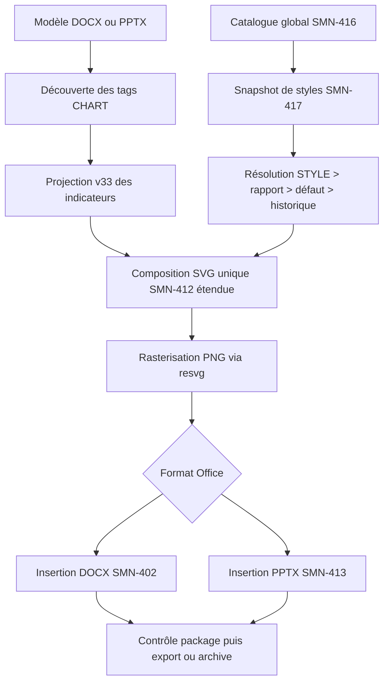

# SMN-418 — Unification du moteur SVG pour les graphiques Word et PowerPoint

**BMAD / Amelia — 8 novembre 2026**  
**Jira :** [SMN-418](https://lmn24.atlassian.net/browse/SMN-418) · **Epic :** [SMN-6](https://lmn24.atlassian.net/browse/SMN-6)  
**Statut :** code et tests publiés sur `main` ; **recette Microsoft Office et benchmark de non-régression à confirmer avant clôture**.

## Objectif

Partager la **même composition SVG et la même rasterisation resvg/PNG** pour les exports DOCX et PPTX lorsque les styles graphiques globaux sont disponibles. Ne pas changer les valeurs des indicateurs v33. Les adaptateurs d'insertion OOXML demeurent séparés pour préserver la structure Word/PowerPoint.

## Parcours de production



**Chargement du catalogue :** au maximum un snapshot en lecture seule `REPEATABLE READ` par export possédant des graphiques ; pas de requête de style à chaque graphique. Les références explicitement invalides sont rejetées.

## Livrables techniques

- `scripts/smn-412-adaptive-chart.mjs` : composition SVG commune, avec objet `style` facultatif déclaré dans le contrat TypeScript/JSDoc et mêmes protections de dimensions, ratios et limites de PNG.
- `src/server/reports/office-indicator-charts.ts` : `renderOfficeIndicatorSharedChart` conserve la sélection unique des séries de projection v33, puis déclenche le même rendu SVG/resvg pour Word et PowerPoint.
- `src/app/api/admin/reports/office-templates/generate/route.ts` : charge le snapshot global une fois si des graphiques sont présents, utilise le résolveur SMN-417 et le moteur partagé ; la validation du package précède toujours la sauvegarde.
- `src/server/reports/office-chart-style-resolver.ts` : accepte également `STYLE=legacy` comme profil interne de compatibilité.
- `src/server/reports/chart-style-contract.ts` : réserve le nom technique `legacy` pour éviter tout conflit avec un style personnalisé.
- `tests/smn-418-unified-office-charts.test.ts` : essais des six types et deux formats, styles, palettes, options, null/zéro/négatif, insertion et intégrité des packages.
- `tests/smn-413-office-route.test.mjs` : contrat d'intégration mis à jour sans suppression des garde-fous sur les archives.
- `.github/workflows/smn-418-unified-office.yml` : tests Node/pnpm, typage, lint et i18n sur Linux et Windows. Aucun `uv`.
- `scripts/poc/smn-418-compare-baseline.ts` : comparaison reproductible des images et métriques avec la baseline SMN-415, sans modifier cette baseline.

## Options prises en charge

| Famille | Comportement |
|---|---|
| Général | Palette de 1 à 6 couleurs, fond, texte, police, taille, marges, titres/sous-titres, légende, étiquettes et précision numérique |
| Barres | Verticales ou horizontales, groupées ou empilées, espacement et arrondis |
| Courbes | Épaisseur, marqueurs, interpolation lissée, labels, axes |
| Aires | Opacité, empilement avec cumuls positifs/négatifs et valeurs absentes conservées |
| Secteurs | Couleurs, séparation des tranches, valeurs et pourcentages, légendes |
| Anneaux | Rayon intérieur variable, valeur centrale optionnelle, légendes |
| Jauges | Épaisseur, bornes configurées (dans les limites du contrat v1), seuils gradués, valeur centrale |

**Limites de cette livraison :** les choix cosmétiques restent bornés par la géométrie de l'emplacement ; des configurations trop volumineuses peuvent retourner `office-chart-frame-too-small`. Les graphiques sont toujours exportés en PNG (non éditables comme graphiques natifs Office). Le sélecteur de style facultatif global dans la page de génération est réservé à **SMN-421** ; le résolveur sait déjà recevoir cette option, mais SMN-418 ne modifie pas encore l'écran M3.

## Compatibilité et protections

1. **Modèle sans STYLE :** le tag historique `{{CHART:TREND}}` et les paramètres `TYPE/TAGS/LAST` restent acceptés.
2. **Base sans tables SMN-416 :** les moteurs historiques restent disponibles et le générateur continue de fonctionner pour les modèles existants. Une référence explicite à un style indisponible entraîne une erreur, jamais un repli silencieux.
3. **Catalogue disponible :** le style global par défaut du type est utilisé, avec une présentation volontairement harmonisée entre Word et PPTX.
4. **STYLE=legacy :** le tag demande explicitement l'ancien moteur historique, même si un catalogue a été installé.
5. **Géométrie :** pour Word, les graphiques utilisent 960×560 px, soit la taille historique de ses PNG ; pour PowerPoint, résolution adaptative à la zone ciblée, à 300 ppp.
6. **Données :** les règles de sélection des indicateurs et des séries v33, unités homogènes, valeurs absentes distinctes de zéro, séries 1–6 et cycles 1–24 sont préservées. Jauge initiale à 0–100 %.
7. **Archivage :** les rapports précédemment produits ne sont pas recalculés ; un document n'est pas enregistré en cas d'échec de son insertion ou validation.
8. **Sécurité :** les styles sont déclaratifs et vérifiés par le contrat serveur SMN-416 ; ni XML/SVG arbitraire ni code utilisateur injectés.

### Preuve de compatibilité contrôlée sans rasterisation
Une évaluation de la fonction pure `composeAdaptiveChart` a comparé les scènes sans style contre le moteur antérieur à SMN-418 pour les six types, avec mêmes données et dimensions : les six SVG ont été identiques caractère par caractère sur les fixtures évaluées. **Cette comparaison ciblée ne remplace pas les tests PNG/Office de la CI**.

## Commandes de tests Node 24 / Windows 11

Depuis la racine de SMN après synchronisation GitHub Desktop :

```powershell
pnpm test:smn-418
node --test tests/smn-413-office-route.test.mjs tests/smn-415-office-baseline.test.mjs
pnpm typecheck
pnpm lint
pnpm i18n:check
```

La CI dédiée exécute ces vérifications sur Linux et Windows. Elle ne lance pas `uv`.

## Comparaison avec la baseline SMN-415 (que l'utilisateur a déjà produite)

Le répertoire SMN-415 initial ne doit jamais être modifié. Si le `baseline.json` existe sous `$env:TEMP\smn-415-before` :

```powershell
pnpm exec tsx scripts/poc/smn-418-compare-baseline.ts --before "$env:TEMP\smn-415-before" --out "$env:TEMP\smn-418-after" --repeats 3 --style cockpit-agile
```

Le script génère `smn-418-after/images` (48 PNG), `comparison.json` et une checklist `RECETTE-OFFICE.md`. Il compare les dimensions, empreintes et durées médianes aux mêmes scénarios SMN-415. L'objectif initial de régression médiane ≤10 % est un **seuil proposé**, pas une preuve acquise. Les différences visuelles Word avant/après sont **attendues** après migration : ancien moteur bitmap versus rendu SVG.

Si l'installation locale SMN utilise toujours v33 sans tables du catalogue, vérifier `pnpm db:check:smn-416` ; avant toute migration `--apply`, **réaliser et vérifier une sauvegarde** conformément à la documentation SMN-416. Ne pas appliquer une migration à l'aveugle.

## Recette manuelle Office encore indispensable

- [ ] Ouvrir de véritables rapports DOCX et PPTX sous Microsoft Office Windows 11.
- [ ] Vérifier les six types avec les trois styles prédéfinis et plusieurs styles personnalisés.
- [ ] Vérifier ratio horizontal/carré/vertical PowerPoint ; Word 960×560 ; lisibilité à 100 % et absence de pixellisation excessive.
- [ ] Vérifier graphiques 1/3/6 dans un même modèle, les tables, logos, images, drapeaux et zones textuelles voisines.
- [ ] Vérifier FR/EN, noms de sprint longs, unités incompatibles, valeurs N/D, zéros et valeurs négatives autorisées.
- [ ] Vérifier `STYLE=legacy`, style explicite absent, défaut global, comportement sans migration.
- [ ] Contrôler l'écart de durée et de mémoire sur le même poste que SMN-415.
- [ ] Conserver les captures et anomalies éventuelles dans le journal de recette Jira.

**Statut :** aucun résultat d'ouverture manuelle Office ni benchmark Windows n'a été communiqué pour SMN-418 ; ne pas déclarer la Story « Terminé » sur la seule compilation.
