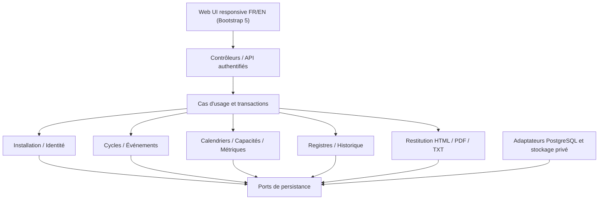

# Architecture Spine — Scrum Master Notebook

> **Contrat de cohérence architectural, non constat d'implémentation.** Les AD-1 à AD-13 reprennent sans renumérotation les décisions déjà enregistrées dans le journal de cette branche. Les AD suivantes distillent les validations conversationnelles de Winston. Le PRD et ses annexes prévalent pour les règles métier. **Statut final du contrat documentaire, avec réserves à portes de sortie** : le lint officiel BMAD, les relectures indépendantes, les versions/bibliothèques, le packaging Windows et les tests métier ne sont pas attestés. Les décisions métier A7/A8/A10/A11 demeurent ouvertes. Voir [revue finale des arbitrages](ARBITRAGES-FINAUX.md).

## Design Paradigm

**Monolithe modulaire TypeScript, application web locale d'abord.** Un seul ensemble applicatif, séparant présentation, cas d'usage/orchestration, domaine pur, persistance et adaptateurs d'export ; PostgreSQL dès le MVP. Dépendances : `UI/API → Application → Domaine` et `Infrastructure → contrats du Domaine/Application`. Le domaine ne dépend ni de React/Next.js, ni de PostgreSQL, ni de Bootstrap. Aucun accès SQL direct depuis les vues. Un propriétaire par agrégat métier ; orchestration explicite des opérations entre modules.



## Invariants & Rules

### AD-1 — Monolithe modulaire [ADOPTED]
- **Binds:** tous les modules MVP ; extension SAFe.
- **Prevents:** microservices et déploiements disparates sans nécessité métier.
- **Rule:** livrer un ensemble applicatif ; modules internes à interfaces explicites, sans services distribués imposés.

### AD-2 — Propriétaire unique par donnée [ADOPTED]
- **Binds:** installation, membres, cycles, objectifs/mesures, registres, restitution.
- **Prevents:** copies divergentes et écritures directes croisées.
- **Rule:** toute mutation passe par le module propriétaire ; les autres consomment des contrats de lecture ou des opérations de ce propriétaire.

### AD-3 — Orchestration des mutations transverses [ADOPTED]
- **Binds:** génération, replanification, clôture, import, audit.
- **Prevents:** états partiellement persistés et traces de faux succès.
- **Rule:** un cas d'usage coordonne la transaction PostgreSQL unique lorsqu'une opération est atomique ; les blocs de bilan restent sauvegardables indépendamment selon D-PRD-071.

### AD-4 — Domaine indépendant des adaptateurs [ADOPTED]
- **Binds:** validation, calcul, autorisation métier et transitions.
- **Prevents:** règles différentes selon formulaire, import ou traitement automatique.
- **Rule:** mettre les règles déterministes dans des services TypeScript testables indépendamment de l'UI et de la base.

### AD-5 — Mutualiser sans assimiler les modes [ADOPTED]
- **Binds:** Scrum/Kanban MVP et SAFe v1.0.
- **Prevents:** deux implémentations d'une même règle ou des métriques Scrum artificielles en Kanban.
- **Rule:** mutualiser cycles, calendrier, capacité, registres et restitution seulement quand la signification est commune ; spécialiser les règles et KPI ; pas d'ART au MVP.

### AD-6 — Sélection métier commune aux restitutions [ADOPTED]
- **Binds:** FR-26–33 et FR-50–57.
- **Prevents:** chiffres HTML/PDF/TXT divergents ou fuite par un moteur de rendu.
- **Rule:** construire un modèle de données autorisées avant rendu ; aucun renderer ne recalcule les métriques ni ne modifie les sources.

### AD-7 — Authentification hors installation initiale [ADOPTED]
- **Binds:** pages, commandes, fichiers privés.
- **Prevents:** exposition anonyme et réutilisation de l'assistant d'installation.
- **Rule:** parcours vierge limité au poste local, à usage unique ; après initialisation, identité et autorisation serveur requises pour chaque consultation, action et téléchargement.

### AD-8 — Comptes et permissions distincts des membres [ADOPTED]
- **Binds:** identité, administration et accès documents.
- **Prevents:** permission implicite des membres ou lecture sans habilitation.
- **Rule:** conserver les **garanties initialement approuvées** : Administrateur administre, l'ancien profil Utilisateur consulte les données collectives et télécharge les documents autorisés sans droit d'édition, et les données individuelles sensibles ne sont pas accessibles à ce profil. **La cardinalité initiale de deux rôles est étendue chronologiquement par AD-31**, sans perte de ce droit de téléchargement ni octroi tacite de droits individuels au nouveau rôle Opérateur.

### AD-9 — Comptes créés dans l'administration [ADOPTED]
- **Binds:** MVP FR-66/72.
- **Prevents:** provisionnement manuel direct en SQL.
- **Rule:** l'administrateur crée les comptes et attribue les rôles depuis l'application ; aucun compte automatique pour un membre d'équipe. Amorçage sur installation vierge uniquement, changement imposé du secret initial ; ne publier aucun mot de passe.

### AD-10 — Confidentialité et secrets [ADOPTED]
- **Binds:** identité, données individuelles, exports, sauvegardes.
- **Prevents:** mots de passe en clair, clés dans le dépôt ou confidentialité contournée.
- **Rule:** dérivation des mots de passe salée et adaptée ; secrets hors Git et hors base ; chiffrement authentifié ciblé des coordonnées et motifs individuels, avec gestion des clés à préciser ; textes libres et archives soumis à contrôles distincts.

### AD-11 — Réconciliation temporelle sans faux passé [ADOPTED]
- **Binds:** cycles, capacités, application pouvant être arrêtée.
- **Prevents:** gel rétroactif calculé avec des informations tardives.
- **Rule:** transition à effet métier distinct du traitement réel, reprise idempotente ; n'utiliser que les données dont la disponibilité à l'ouverture est démontrable, sinon signaler la capacité initiale indéterminable.

### AD-12 — Paramètres des membres à effet daté [ADOPTED]
- **Binds:** affectations, rôles, localisation, calendriers et capacités.
- **Prevents:** modification rétrospective du passé par des paramètres actuels.
- **Rule:** conserver des périodes d'effet et l'historique des changements ; reconstitution historique fondée sur l'état de connaissance vérifiable.

### AD-13 — Dépassement Scrum autorisé [ADOPTED]
- **Binds:** saisie et import SP, bilan et taux Scrum.
- **Prevents:** refus arbitraire ou plafonnement des résultats au-delà de l'engagement.
- **Rule:** SP terminés > engagement final est accepté ; taux > 100 % permis, alerte non bloquante accessible ; ne modifier ni sources ni formules pour masquer le dépassement.

### AD-14 — Sémantique temporelle commune [ADOPTED]
- **Binds:** tous les cycles, événements, disponibilités, audits.
- **Prevents:** confusion jours civils / instants ou décalage aux changements d'heure.
- **Rule:** dates civiles pour les journées ; horaires locaux avec identifiant IANA pour la planification ; instants UTC pour chronologie et audit. Pas de génération de semaines par ajout mécanique de 168 h UTC.

### AD-15 — Intervalles et chevauchements [ADOPTED]
- **Binds:** Scrum, Kanban, événements, temps de travail.
- **Prevents:** faux chevauchements de périodes contiguës, fin de mois tronquée.
- **Rule:** stocker/raisonner avec intervalles semi-ouverts [début, fin), afficher la fin métier incluse si nécessaire ; interdire les cycles chevauchants dans un même périmètre, pas entre équipes distinctes.

### AD-16 — Calendrier et capacité sans double déduction [ADOPTED]
- **Binds:** FR-8–14/19.
- **Prevents:** cumul d'absences/jours fériés/fermetures et conversion injustifiée SP/JH.
- **Rule:** une disponibilité centrale par membre croise plages travaillées, indisponibilités, affectations et parts Développeur ; préserver inconnue ≠ zéro, valeur manuelle prioritaire, capacité initiale figée, 8 h/JH par défaut configurable. Seules réunions exceptionnelles activées réduisent facultativement la capacité.

### AD-17 — Génération explicite et événements matérialisés [ADOPTED]
- **Binds:** FR-15–18/23–24.
- **Prevents:** cycles créés spontanément, occurrences réécrites par un modèle changé.
- **Rule:** génération unitaire ou par lot à la demande (6 Sprints / 6 Kanban / 3 PI futur), aperçu obligatoire si X > 1, tout-ou-rien ; occurrences identifiées et historisées. Aucun événement Scrum généré pour un Sprint rétrosaisi après sa fin.

### AD-18 — Cycle de vie et événements historiques protégés [ADOPTED]
- **Binds:** statut des périodes, événements et replanification.
- **Prevents:** clôture implicite, déplacement d'événements tenus ou écrasement de métriques.
- **Rule:** À venir → En cours → Terminé automatiquement selon conditions, Clôturé seulement sur confirmation ; replanification atomique avec choix conserver/recalculer, recalcul limité aux événements futurs générés, non personnalisés et sans statut historique.

### AD-19 — Révisions métier et temporalité [ADOPTED]
- **Binds:** métriques, référentiels, paramètres, opérations sensibles.
- **Prevents:** corrections invisibles et confusion époque représentée / enregistrement.
- **Rule:** données courantes + révisions + audits distincts ; auteur/instant/source/qualité et versions suivis. Ne jamais reconstruire un événement non documenté ; calculs dérivés à partir des sources disponibles.

### AD-20 — Clôtures versionnées immuables [ADOPTED]
- **Binds:** six registres, cycles, nouveaux bilans et rapports.
- **Prevents:** remplacement silencieux d'une photographie qualitative V1 après reclôture.
- **Rule:** chaque clôture effective produit atomiquement une Vn et ses associations ; cycle clôturé lit dernière Vn, cycle rouvert lit courant, toutes Vn antérieures restent consultables ; aucun snapshot fictif d'époque pour une reprise.

### AD-21 — Import CSV strict et atomique [ADOPTED]
- **Binds:** FR-42–49 ; Scrum/Kanban.
- **Prevents:** écriture partielle, champs existants écrasés ou import de KPI dérivés.
- **Rule:** colonnes strictes `cycle_id,metric_code,value,quality`, qualité `known|estimated`; cycles existants, codes sources et unités compatibles, doublons/erreurs rejettent tout le fichier, prévisualisation puis confirmation ; conserver les valeurs existantes par défaut, remplacement explicite et réévaluation de concurrence.

### AD-22 — Restitution multitemporelle fidèle [ADOPTED]
- **Binds:** HTML, PDF, TXT, tendances et anciennes versions.
- **Prevents:** rapport mêlant présent et passé comme s'ils étaient contemporains.
- **Rule:** modèle documentaire typé + manifeste de génération (sources, période, qualité, clôture Vn, heure) ; aperçu et export partagent un même contenu résolu ; cinq cycles clôturés comparables maximum pour les tendances.

### AD-23 — Politique IA plus restrictive [ADOPTED]
- **Binds:** briefs TXT et analyses.
- **Prevents:** exposition de données individuelles par modèle ou texte exporté automatiquement.
- **Rule:** exclusion structurelle de tous champs individuels de membres avant rendu TXT, revue explicite des textes libres, aucun transfert/API IA automatique ; analyses distinguées des faits et des chiffres.

### AD-24 — Archives TXT et analyses associées [ADOPTED]
- **Binds:** FR-50–57.
- **Prevents:** régénération des anciens briefs et analyses multiples contradictoires.
- **Rule:** conserver exactement le TXT final archivé, immuable ; duplication avec identifiant parent ; au plus une analyse IA active liée par brief, suppression de l'analyse sans effacement du TXT ; origine IA et retouches humaines visibles.

### AD-25 — PostgreSQL unique dès le MVP [ADOPTED]
- **Binds:** données, transactions, migrations, backups et portabilité future.
- **Prevents:** divergence entre SQLite local et PostgreSQL distant.
- **Rule:** persister dans PostgreSQL, utiliser contraintes, transactions et migrations versionnées ; pas de bascule SQLite prévue. Instance locale fonctionnelle déclarée par l'utilisateur, non vérifiée par l'agent.

### AD-26 — Identité et documents contrôlés côté serveur [ADOPTED]
- **Binds:** sessions, comptes, PDF/TXT et fichiers privés.
- **Prevents:** contrôle purement UI, IDOR et URL publique de fichier.
- **Rule:** chaque lecture/action/téléchargement est autorisé côté serveur ; sessions révocables, cookies protégés ; aucun contenu métier anonyme après installation. Le RBAC suit AD-8 **étendu par AD-31** ; les permissions sensibles nécessitent une décision explicite.

### AD-27 — Base et stockage privé cohérents [ADOPTED]
- **Binds:** archives, exports et restauration.
- **Prevents:** fichier déclaré archivé sans fichier ou métadonnées associées.
- **Rule:** TXT définitif stocké de préférence transactionnellement dans PostgreSQL avec empreinte ; PDF par rendu local contrôlé, non archivé systématiquement sans décision A10 ; stockage privé à état de finalisation explicite.

### AD-28 — Déploiement utilisateur et évolutivité [ADOPTED]
- **Binds:** I0, Windows local et éventuel web.
- **Prevents:** dépendance imposée à Docker, service Windows, IDE ou droits admin.
- **Rule:** serveur TypeScript/Node lancé dans la session utilisateur, accès local limité initialement à loopback ; production et accès réseau soumis à configuration de sécurité dédiée ; interface web responsive. React/Next.js candidats, pas versions gelées avant POC.

### AD-29 — Exploitation et conservation vérifiables [ADOPTED]
- **Binds:** migrations, sauvegardes/restaurations, erreurs, journaux.
- **Prevents:** backups incohérents et succès fictifs.
- **Rule:** backup PostgreSQL + archives réellement stockées avec manifeste et test de restauration ; migration versionnée avec backup préalable ; journaux métier/sécurité/techniques séparés, sans secrets ; échecs explicités. RPO/RTO/fréquence/rétention non approuvés définitivement.

### AD-30 — Vérification progressive et portes de sortie [ADOPTED]
- **Binds:** incréments I0–I6, FR-74–81.
- **Prevents:** revendication de qualité sans preuve ni glissement SAFe dans MVP.
- **Rule:** POC I0 PostgreSQL/auth/packaging/PDF, tests unitaires/intégration/E2E, grille FR↔tests/preuves ; cinq conditions cumulatives validées humainement avant pilote, non réputées atteintes par approbation documentaire.

### AD-31 — Évolution contrôlée des profils d'accès [ADOPTED]
- **Binds:** identité/permissions FR-66–67/72, comptes MVP, rapports/briefs et données individuelles ; étend AD-8/9 selon la validation globale ultérieure AD-SEC.
- **Prevents:** appliquer en silence le vieux périmètre à deux rôles en ignorant la proposition approuvée à trois rôles, ou faire perdre le droit de téléchargement du lecteur.
- **Rule:** retenir trois profils architecturaux **Administrateur**, **Opérateur SM/RTE**, **Lecteur** : l'Administrateur administre et opère ; l'Opérateur gère les activités métier dans le périmètre autorisé ; le Lecteur consulte les données collectives et télécharge les rapports/briefs autorisés, sans édition. Les données individuelles nominatives restent interdites au Lecteur ; **l'Opérateur ne reçoit aucun droit individuel sensible par défaut**, sa matrice de permissions détaillée restant soumise à accord métier avant les Stories de comptes. Toutes les permissions sont contrôlées côté serveur. Aucune création de compte automatique pour les équipiers.

## Consistency Conventions

| Concern | Convention contraignante |
| --- | --- |
| Identifiants | IDs stables indépendants des libellés ; noms de cycles non uniques autorisés |
| Provenance | `manual/import/calculated` distinct de `known/estimated/unreported` ; valeur zéro explicitement fournie distincte de NULL |
| Nombres | `numeric` PostgreSQL / calcul décimal TypeScript, sans arrondi silencieux |
| Temps | IANA + heure locale pour configuration ; instant UTC pour audit ; intervalles [début,fin) |
| Écritures | Contrôles côté serveur, opérations sensibles transactionnelles, versions pour concurrence optimiste |
| Calculs | Une librairie domaine pure, prévisualisation informative ; serveur décide la validité de l'écriture |
| Architecture | Un propriétaire par agrégat ; pas de SQL dans les composants UI ; pas de dépendance du domaine aux adaptateurs |
| Confidentialité | Rapport privé par défaut ; TXT collectif filtré avant rendu ; aucune URL anonyme des archives ; RBAC AD-8/31 sans privilège sensible implicite |
| Documentation | FR/F/D-PRD inchangés ; AD-1–AD-13 conservés et AD-31 ajoutée sans renumérotation ; décisions justifiées dans memlog |
| Déploiement | PostgreSQL obligatoire, Windows utilisateur en cible initiale ; aucun secret dans GitHub |

## Stack — décision et vérification

| Élément | État |
| --- | --- |
| TypeScript | **Approuvé** — version à épingler après vérification |
| PostgreSQL | **Approuvé** — version locale de référence à relever, cible supportée à figer |
| Node.js, pnpm, Bootstrap 5 | Node/pnpm disponibles et Bootstrap retenu ; versions à figer |
| React, Next.js | **Candidats approuvés sous réserve de POC**, pas de version vérifiée |
| ORM, PDF, tests, bibliothèque temporelle | **Non figés** — compatibilité/version/sécurité à vérifier avec autorisation de recherche ou POC |

## Structural Seed

```text
src/
  app/             # UI, routes, handlers HTTP
  modules/         # installation, identité, membres, calendrier, cycles,
                   # métriques/capacités, registres, historique, rapports, briefs
  shared/domain/   # valeurs, ports et règles transverses
  infrastructure/  # PostgreSQL, migrations, stockage, rendu PDF, secrets
  tests/           # unitaires, intégration, E2E et fixtures
```

**Contexte de déploiement :** navigateur local → serveur Node utilisateur (loopback) → PostgreSQL local → archives privées. En hébergement futur, proxy HTTPS → serveur Node → PostgreSQL serveur ; la même couche métier ne doit pas dépendre de la machine ou du chemin du fichier local.

## Capability → Architecture Map

| FR / capacité | Propriétaire | Invariants principaux | Incrément principal |
| --- | --- | --- | --- |
| FR-1–7 installation, organisation, équipes | Installation/Identity/Teams | AD-2/7/8/9/25/28/31 | I0–I1 |
| FR-8–14 membres, absences, capacité | Members/Calendar/Capacity | AD-11/12/14/16/19 | I1–I2 |
| FR-15–24 cycles, événements, Scrum/Kanban | Cycle/Event/Metric | AD-3/5/13/15/17/18 | I1–I3 |
| FR-25 et FR-34–41 registres | Registers/Closure | AD-2/19/20 | I2–I3 |
| FR-26–33 reporting HTML/PDF | Reporting | AD-6/22/26/27 | I1–I3 |
| FR-42–49 reprise et CSV | History/Import | AD-19/20/21 | I4 |
| FR-50–57 TXT et analyses IA | Brief/Analysis | AD-6/23/24/27 | I5 |
| FR-58–65 UX | Web/UI + tous modules | AD-4/5/7/28 | I0–I5 |
| FR-66–73 sécurité/exploitation | Identity/Infrastructure | AD-7/8/10/25–29/31 | Dès I0 |
| FR-74–81 recette | Test/Quality | AD-30 | I6 (preuves dès I0) |

## Deferred — réserves explicites

- **A5 :** seuils NFR, matériel/volumes de référence, navigateurs cibles, niveaux WCAG et RPO/RTO à valider après POC ; objectifs précédemment proposés non contractuels.
- **A7 / A8 :** classes exactes de matrice 3×3 et catalogue de faits marquants automatiques ; arbitrages fonctionnels préalables aux Stories.
- **A9 :** reprise manuelle complète de périodes Kanban passées non acquise au MVP ; import de métriques sur cycles existants acquis.
- **A10 :** archivage systématique/rétention des PDF non décidés ; PDF exporté non réécrit et consultation privée obligatoires.
- **A11 :** suppression/anonymisation personnelle, rémanence en snapshots/archives/backups à arbitrer avant implémentation et pilote.
- **A12 :** rendu multitemporel couvert par AD-19/20/22 ; scénarios de restitution non testés.
- **Rôles, droits individuels :** AD-31 rapproche la proposition ultérieure à trois rôles et le profil Utilisateur d'AD-8 devenu Lecteur ; les droits d'accès de l'Opérateur aux absences, coordonnées et capacités individuelles **restent à arbitrer avant les Stories correspondantes**. Aucun accès sensible n'est accordé par défaut.
- **Amorçage :** identifiant de compte initial déjà consigné dans le journal ; mécanisme de secret temporaire, récupération et rotation à spécifier sans exposer de secret.
- **Versions et starter :** recherche web avancée non autorisée ; versions des frameworks, chiffrement, pilotes PostgreSQL, calendriers et export PDF à éprouver en I0 avant engagement.
- **Implémentation et qualité :** absence d'architecture exécutée ; linter/reviewer gate BMAD, scripts `uv`, tests et tests de restauration non exécutés ; validation documentaire indépendante à réaliser après production de la spine.
