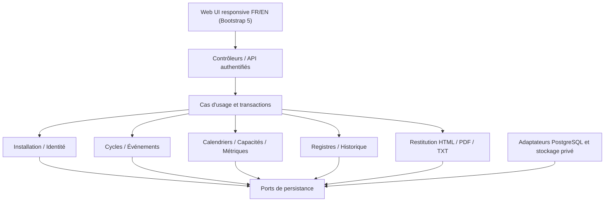

# Architecture Spine — Scrum Master Notebook

> **Contrat de cohérence architectural, non constat d'implémentation.** Les AD-1 à AD-13 reprennent sans renumérotation les décisions déjà enregistrées dans le journal de cette branche. Les AD suivantes distillent les validations conversationnelles de Winston. Le PRD et ses annexes prévalent pour les règles métier. **Statut final du contrat documentaire, avec réserves à portes de sortie** : le lint officiel BMAD, les relectures indépendantes, les versions/bibliothèques, le packaging Windows et les tests métier ne sont pas attestés. Les décisions **A7/A8/A10/A11 sont maintenant validées**, et AD-31 précise **Administrateur / Utilisateur uniquement au MVP** (D-PRD-132 à 136). Voir [revue finale des arbitrages](ARBITRAGES-FINAUX.md) et [contrôle final documentaire](CONTROLE-FINAL-BMAD.md).

> **Amendement architectural D-PRD-137 :** un produit fixe et exactement une équipe au MVP Scrum/Kanban ; plusieurs équipes seulement au sein du train SAFe v1.0. Les quatre contenus Vision/Product Goal/DoD/DoR sont possédés par l'équipe au MVP et par le train en SAFe. Cette précision borne les règles multiéquipes des AD, sans développer SAFe.

## Design Paradigm

> **Décision d'architecture complémentaire du 20/10/2026 — obligatoire dans tous les modules :** [ADR-I0-004 — internationalisation JSON](ADR-I0-004-I18N-JSON.md). Un fichier JSON de ressources **par langue** (`src/i18n/fr.json`, `src/i18n/en.json`, chemins cibles) constitue l'unique source des libellés SMN. Les pages, composants, formulaires, notifications, diagnostics visibles, tableaux de bord, rendus et exports standardisés utilisent des clés de traduction, jamais du texte utilisateur codé en dur ni des ternaires FR/EN dans les composants. Choix de langue connecté aux paramètres persistés SMN-18 dans la Story SMN-27 ; langue française comme repli ; les contenus métier libres ne sont ni traduits ni réécrits. Toute Epic doit satisfaire cette règle et ses tests. **Il s'agit d'une décision, pas d'une implémentation accomplie.**


**Monolithe modulaire TypeScript, application web locale d'abord.** Un seul ensemble applicatif, séparant présentation, cas d'usage/orchestration, domaine pur, persistance et adaptateurs d'export ; PostgreSQL dès le MVP. Dépendances : `UI/API → Application → Domaine` et `Infrastructure → contrats du Domaine/Application`. Le domaine ne dépend ni de React/Next.js, ni de PostgreSQL, ni de Bootstrap. Aucun accès SQL direct depuis les vues. Un propriétaire par agrégat métier ; orchestration explicite des opérations entre modules.



## Invariants & Rules

### AD-1 — Monolithe modulaire [ADOPTED]
- **Binds:** tous les modules MVP ; extension SAFe.
- **Prevents:** microservices et déploiements disparates sans nécessité métier.
- **Rule:** livrer un ensemble applicatif ; modules internes à interfaces explicites, sans services distribués imposés.

### AD-2 — Propriétaire unique par donnée [ADOPTED]
- **Binds:** installation, membres, cycles, objectifs/mesures, registres, restitution.
- **Prevents:** copies divergentes et écritures directes croisées.
- **Rule:** toute mutation passe par le module propriétaire ; Organisation possède les contenus et versions Vision/Product Goal/DoD/DoR avec référence d'équipe au MVP, référence ART en SAFe futur ; les autres consomment des contrats de lecture ou des opérations de ce propriétaire.

### AD-3 — Orchestration des mutations transverses [ADOPTED]
- **Binds:** génération, replanification, clôture, import, audit.
- **Prevents:** états partiellement persistés et traces de faux succès.
- **Rule:** un cas d'usage coordonne la transaction PostgreSQL unique lorsqu'une opération est atomique ; les blocs de bilan restent sauvegardables indépendamment selon D-PRD-071.

### AD-4 — Domaine indépendant des adaptateurs [ADOPTED]
- **Binds:** validation, calcul, autorisation métier et transitions.
- **Prevents:** règles différentes selon formulaire, import ou traitement automatique.
- **Rule:** mettre les règles déterministes dans des services TypeScript testables indépendamment de l'UI et de la base.

### AD-5 — Mutualiser sans assimiler les modes [ADOPTED]
- **Binds:** Scrum/Kanban MVP et SAFe v1.0.
- **Prevents:** deux implémentations d'une même règle ou des métriques Scrum artificielles en Kanban.
- **Rule:** mutualiser cycles, calendrier, capacité, registres et restitution seulement quand la signification est commune ; spécialiser les règles et KPI ; pas d'ART au MVP.

### AD-6 — Sélection métier commune aux restitutions [ADOPTED]
- **Binds:** FR-26–33 et FR-50–57.
- **Prevents:** chiffres HTML/PDF/TXT divergents ou fuite par un moteur de rendu.
- **Rule:** construire un modèle de données autorisées avant rendu ; aucun renderer ne recalcule les métriques ni ne modifie les sources.

### AD-7 — Authentification hors installation initiale [ADOPTED]
- **Binds:** pages, commandes, fichiers privés.
- **Prevents:** exposition anonyme et réutilisation de l'assistant d'installation.
- **Rule:** parcours vierge limité au poste local, à usage unique ; après initialisation, identité et autorisation serveur requises pour chaque consultation, action et téléchargement.

### AD-8 — Comptes et permissions distincts des membres [ADOPTED]
- **Binds:** identité, administration et accès documents.
- **Prevents:** permission implicite des membres ou lecture sans habilitation.
- **Rule:** conserver les **garanties initialement approuvées** : Administrateur administre, l'ancien profil Utilisateur consulte les données collectives et télécharge les documents autorisés sans droit d'édition, et les données individuelles sensibles ne sont pas accessibles à ce profil. **D-PRD-136 corrige cette extension : deux rôles seulement au MVP, Administrateur et Utilisateur** ; l'hypothèse Opérateur/Lecteur à trois profils reste historique, non applicable à l'implémentation du MVP.

### AD-9 — Comptes créés dans l'administration [ADOPTED]
- **Binds:** MVP FR-66/72.
- **Prevents:** provisionnement manuel direct en SQL.
- **Rule:** l'administrateur crée les comptes et attribue les rôles depuis l'application ; aucun compte automatique pour un membre d'équipe. Amorçage sur installation vierge uniquement, changement imposé du secret initial ; ne publier aucun mot de passe.

### AD-10 — Confidentialité et secrets [ADOPTED]
- **Binds:** identité, données individuelles, exports, sauvegardes.
- **Prevents:** mots de passe en clair, clés dans le dépôt ou confidentialité contournée.
- **Rule:** dérivation des mots de passe salée et adaptée ; secrets hors Git et hors base ; chiffrement authentifié ciblé des coordonnées et motifs individuels, avec gestion des clés à préciser ; textes libres et archives soumis à contrôles distincts.

### AD-11 — Réconciliation temporelle sans faux passé [ADOPTED]
- **Binds:** cycles, capacités, application pouvant être arrêtée.
- **Prevents:** gel rétroactif calculé avec des informations tardives.
- **Rule:** transition à effet métier distinct du traitement réel, reprise idempotente ; n'utiliser que les données dont la disponibilité à l'ouverture est démontrable, sinon signaler la capacité initiale indéterminable.

### AD-12 — Paramètres des membres à effet daté [ADOPTED]
- **Binds:** affectations, rôles, localisation, calendriers et capacités.
- **Prevents:** modification rétrospective du passé par des paramètres actuels.
- **Rule:** conserver des périodes d'effet et l'historique des changements ; reconstitution historique fondée sur l'état de connaissance vérifiable.

### AD-13 — Dépassement Scrum autorisé [ADOPTED]
- **Binds:** saisie et import SP, bilan et taux Scrum.
- **Prevents:** refus arbitraire ou plafonnement des résultats au-delà de l'engagement.
- **Rule:** SP terminés > engagement final est accepté ; taux > 100 % permis, alerte non bloquante accessible ; ne modifier ni sources ni formules pour masquer le dépassement.

### AD-14 — Sémantique temporelle commune [ADOPTED]
- **Binds:** tous les cycles, événements, disponibilités, audits.
- **Prevents:** confusion jours civils / instants ou décalage aux changements d'heure.
- **Rule:** dates civiles pour les journées ; horaires locaux avec identifiant IANA pour la planification ; instants UTC pour chronologie et audit. Pas de génération de semaines par ajout mécanique de 168 h UTC.

### AD-15 — Intervalles et chevauchements [ADOPTED]
- **Binds:** Scrum, Kanban, événements, temps de travail.
- **Prevents:** faux chevauchements de périodes contiguës, fin de mois tronquée.
- **Rule:** stocker/raisonner avec intervalles semi-ouverts [début, fin), afficher la fin métier incluse si nécessaire ; interdire les cycles chevauchants dans un même périmètre, pas entre équipes distinctes.

### AD-16 — Calendrier et capacité sans double déduction [ADOPTED]
- **Binds:** FR-8–14/19.
- **Prevents:** cumul d'absences/jours fériés/fermetures et conversion injustifiée SP/JH.
- **Rule:** une disponibilité centrale par membre croise plages travaillées, indisponibilités, affectations et parts Développeur ; préserver inconnue ≠ zéro, valeur manuelle prioritaire, capacité initiale figée, 8 h/JH par défaut configurable. Seules réunions exceptionnelles activées réduisent facultativement la capacité.

### AD-17 — Génération explicite et événements matérialisés [ADOPTED]
- **Binds:** FR-15–18/23–24.
- **Prevents:** cycles créés spontanément, occurrences réécrites par un modèle changé.
- **Rule:** génération unitaire ou par lot à la demande (6 Sprints / 6 Kanban / 3 PI futur), aperçu obligatoire si X > 1, tout-ou-rien ; occurrences identifiées et historisées. Aucun événement Scrum généré pour un Sprint rétrosaisi après sa fin.

### AD-18 — Cycle de vie et événements historiques protégés [ADOPTED]
- **Binds:** statut des périodes, événements et replanification.
- **Prevents:** clôture implicite, déplacement d'événements tenus ou écrasement de métriques.
- **Rule:** À venir → En cours → Terminé automatiquement selon conditions, Clôturé seulement sur confirmation ; replanification atomique avec choix conserver/recalculer, recalcul limité aux événements futurs générés, non personnalisés et sans statut historique.

### AD-19 — Révisions métier et temporalité [ADOPTED]
- **Binds:** métriques, référentiels, paramètres, opérations sensibles.
- **Prevents:** corrections invisibles et confusion époque représentée / enregistrement.
- **Rule:** données courantes + révisions + audits distincts ; auteur/instant/source/qualité et versions suivis. Ne jamais reconstruire un événement non documenté ; calculs dérivés à partir des sources disponibles.

### AD-20 — Clôtures versionnées immuables [ADOPTED]
- **Binds:** six registres, cycles, nouveaux bilans et rapports.
- **Prevents:** remplacement silencieux d'une photographie qualitative V1 après reclôture.
- **Rule:** chaque clôture effective produit atomiquement une Vn et ses associations ; cycle clôturé lit dernière Vn, cycle rouvert lit courant, toutes Vn antérieures restent consultables ; aucun snapshot fictif d'époque pour une reprise.

### AD-21 — Import CSV strict et atomique [ADOPTED]
- **Binds:** FR-42–49 ; Scrum/Kanban.
- **Prevents:** écriture partielle, champs existants écrasés ou import de KPI dérivés.
- **Rule:** colonnes strictes `cycle_id,metric_code,value,quality`, qualité `known|estimated`; cycles existants, codes sources et unités compatibles, doublons/erreurs rejettent tout le fichier, prévisualisation puis confirmation ; conserver les valeurs existantes par défaut, remplacement explicite et réévaluation de concurrence.

### AD-22 — Restitution multitemporelle fidèle [ADOPTED]
- **Binds:** HTML, PDF, TXT, tendances et anciennes versions.
- **Prevents:** rapport mêlant présent et passé comme s'ils étaient contemporains.
- **Rule:** modèle documentaire typé + manifeste de génération (sources, période, qualité, clôture Vn, heure) ; aperçu et export partagent un même contenu résolu ; cinq cycles clôturés comparables maximum pour les tendances.

### AD-23 — Politique IA plus restrictive [ADOPTED]
- **Binds:** briefs TXT et analyses.
- **Prevents:** exposition de données individuelles par modèle ou texte exporté automatiquement.
- **Rule:** exclusion structurelle de tous champs individuels de membres avant rendu TXT, revue explicite des textes libres, aucun transfert/API IA automatique ; analyses distinguées des faits et des chiffres.

### AD-24 — Archives TXT et analyses associées [ADOPTED]
- **Binds:** FR-50–57.
- **Prevents:** régénération des anciens briefs et analyses multiples contradictoires.
- **Rule:** conserver exactement le TXT final archivé, immuable ; duplication avec identifiant parent ; au plus une analyse IA active liée par brief, suppression de l'analyse sans effacement du TXT ; origine IA et retouches humaines visibles.

### AD-25 — PostgreSQL unique dès le MVP [ADOPTED]
- **Binds:** données, transactions, migrations, backups et portabilité future.
- **Prevents:** divergence entre SQLite local et PostgreSQL distant.
- **Rule:** persister dans PostgreSQL, utiliser contraintes, transactions et migrations versionnées ; pas de bascule SQLite prévue. Instance locale fonctionnelle déclarée par l'utilisateur, non vérifiée par l'agent.

### AD-26 — Identité et documents contrôlés côté serveur [ADOPTED]
- **Binds:** sessions, comptes, PDF/TXT et fichiers privés.
- **Prevents:** contrôle purement UI, IDOR et URL publique de fichier.
- **Rule:** chaque lecture/action/téléchargement est autorisé côté serveur ; sessions révocables, cookies protégés ; aucun contenu métier anonyme après installation. Le RBAC suit AD-8 **étendu par AD-31** ; les permissions sensibles nécessitent une décision explicite.

### AD-27 — Base et stockage privé cohérents [ADOPTED]
- **Binds:** archives, exports et restauration.
- **Prevents:** fichier déclaré archivé sans fichier ou métadonnées associées.
- **Rule:** TXT définitif stocké de préférence transactionnellement dans PostgreSQL avec empreinte ; PDF par rendu local contrôlé, **archivé automatiquement à chaque export effectivement réussi selon D-PRD-134/A10**, stockage privé à état de finalisation explicite, sauvegarde cohérente et traitement des exceptions d'effacement A11.

### AD-28 — Déploiement utilisateur et évolutivité [ADOPTED]
- **Binds:** I0, Windows local et éventuel web.
- **Prevents:** dépendance imposée à Docker, service Windows, IDE ou droits admin.
- **Rule:** serveur TypeScript/Node lancé dans la session utilisateur, accès local limité initialement à loopback ; production et accès réseau soumis à configuration de sécurité dédiée ; interface web responsive. React/Next.js candidats, pas versions gelées avant POC.

### AD-29 — Exploitation et conservation vérifiables [ADOPTED]
- **Binds:** migrations, sauvegardes/restaurations, erreurs, journaux.
- **Prevents:** backups incohérents et succès fictifs.
- **Rule:** backup PostgreSQL + archives réellement stockées avec manifeste et test de restauration ; migration versionnée avec backup préalable ; journaux métier/sécurité/techniques séparés, sans secrets ; échecs explicités. RPO/RTO et fréquence à confirmer ; **30 jours par défaut pour conservation des sauvegardes gérées selon D-PRD-135**, distincts des PDF sans purge automatique d'ancienneté.

### AD-30 — Vérification progressive et portes de sortie [ADOPTED]
- **Binds:** incréments I0–I6, FR-74–81.
- **Prevents:** revendication de qualité sans preuve ni glissement SAFe dans MVP.
- **Rule:** POC I0 PostgreSQL/auth/packaging/PDF, tests unitaires/intégration/E2E, grille FR↔tests/preuves ; cinq conditions cumulatives validées humainement avant pilote, non réputées atteintes par approbation documentaire.

### AD-31 — Évolution contrôlée des profils d'accès [ADOPTED — CORRIGÉ D-PRD-136]
- **Binds:** identité/permissions FR-66–67/72, comptes MVP, rapports/briefs et données individuelles ; correction de la proposition AD-SEC intermédiaire.
- **Prevents:** introduire au MVP trois profils ou un moteur d'habilitations complexes contre la validation finale ; supprimer le droit de téléchargement de l'Utilisateur.
- **Rule:** exactement **deux profils MVP : Administrateur et Utilisateur**. Le Scrum Master est l'Administrateur de son installation : il gère l'application, équipes, membres, métriques, documents et opérations sensibles. L'Utilisateur est en **lecture seule des données collectives** et peut **consulter/télécharger les PDF/TXT autorisés**, mais ne peut ni éditer, ni générer de documents, ni accéder aux données individuelles, ni administrer. Formulaire de création des comptes par Administrateur au MVP ; aucune création automatique de comptes pour les équipiers. Contrôles côté serveur sur chaque consultation/action/téléchargement. La proposition de trois rôles est conservée dans le journal **comme étape historique supplantée** ; permissions par équipe et rôles avancés différés à une éventuelle version web.

## Consistency Conventions

| Concern | Convention contraignante |
| --- | --- |
| Identifiants | IDs stables indépendants des libellés ; noms de cycles non uniques autorisés |
| Provenance | `manual/import/calculated` distinct de `known/estimated/unreported` ; valeur zéro explicitement fournie distincte de NULL |
| Nombres | `numeric` PostgreSQL / calcul décimal TypeScript, sans arrondi silencieux |
| Temps | IANA + heure locale pour configuration ; instant UTC pour audit ; intervalles [début,fin) |
| Écritures | Contrôles côté serveur, opérations sensibles transactionnelles, versions pour concurrence optimiste |
| Calculs | Une librairie domaine pure, prévisualisation informative ; serveur décide la validité de l'écriture |
| Architecture | Un propriétaire par agrégat ; pas de SQL dans les composants UI ; pas de dépendance du domaine aux adaptateurs |
| Confidentialité | Rapport privé par défaut ; TXT collectif filtré avant rendu ; aucune URL anonyme des archives ; RBAC AD-8/31 sans privilège sensible implicite |
| Documentation | FR/F/D-PRD inchangés ; AD-1–AD-13 conservés et AD-31 ajoutée sans renumérotation ; décisions justifiées dans memlog |
| Déploiement | PostgreSQL obligatoire, Windows utilisateur en cible initiale ; aucun secret dans GitHub |

## Stack — décision et vérification

**Validation utilisateur du 19/10/2026 à 22:29 :** [ADR-I0-001](ADR-I0-001-STACK.md), sous réserve des essais I0.

| Élément | État |
| --- | --- |
| TypeScript | Approuvé ; version exacte à figer |
| PostgreSQL | Approuvé ; version serveur et clients à confirmer |
| Node.js / pnpm | Node 24 LTS et pnpm retenus ; versions déclarées 24.21.0 / 12.10.0, essais non réalisés |
| Bootstrap | 5.3 retenu, sans Tailwind ; correctif à figer |
| React / Next.js | React 19 et Next.js 16 App Router **retenus sous réserve des essais I0** |
| ORM | **Prisma ORM 7 retenu**, adaptateur et migrations à qualifier |
| Authentification | **Better Auth avec sessions PostgreSQL retenu**, contrôles serveur et intégration à éprouver |
| PDF | **Playwright / Chromium local retenu pour qualification I0** |
| Bibliothèque temporelle / tests unitaires | Non figés ; sélection complémentaire à préparer |

Les correctifs exacts ne sont pas verrouillés et aucun résultat Windows n'est acquis. Le monolithe modulaire reste indépendant de ces adaptateurs ; aucun serveur NestJS séparé n'est requis.

## Structural Seed

```text
src/
  app/             # UI, routes, handlers HTTP
  modules/         # installation, identité, membres, calendrier, cycles,
                   # métriques/capacités, registres, historique, rapports, briefs
  shared/domain/   # valeurs, ports et règles transverses
  infrastructure/  # PostgreSQL, migrations, stockage, rendu PDF, secrets
  tests/           # unitaires, intégration, E2E et fixtures
```

**Contexte de déploiement :** navigateur local → serveur Node utilisateur (loopback) → PostgreSQL local → archives privées. En hébergement futur, proxy HTTPS → serveur Node → PostgreSQL serveur ; la même couche métier ne doit pas dépendre de la machine ou du chemin du fichier local.

## Capability → Architecture Map

| FR / capacité | Propriétaire | Invariants principaux | Incrément principal |
| --- | --- | --- | --- |
| FR-1–7 installation, organisation, équipes | Installation/Identity/Teams | AD-2/7/8/9/25/28/31 | I0–I1 |
| FR-8–14 membres, absences, capacité | Members/Calendar/Capacity | AD-11/12/14/16/19 | I1–I2 |
| FR-15–24 cycles, événements, Scrum/Kanban | Cycle/Event/Metric | AD-3/5/13/15/17/18 | I1–I3 |
| FR-25 et FR-34–41 registres | Registers/Closure | AD-2/19/20 | I2–I3 |
| FR-26–33 reporting HTML/PDF | Reporting | AD-6/22/26/27 | I1–I3 |
| FR-42–49 reprise et CSV | History/Import | AD-19/20/21 | I4 |
| FR-50–57 TXT et analyses IA | Brief/Analysis | AD-6/23/24/27 | I5 |
| FR-58–65 UX | Web/UI + tous modules | AD-4/5/7/28 | I0–I5 |
| FR-66–73 sécurité/exploitation | Identity/Infrastructure | AD-7/8/10/25–29/31 | Dès I0 |
| FR-74–81 recette | Test/Quality | AD-30 | I6 (preuves dès I0) |

## Deferred — réserves techniques et décisions métier désormais levées

- **A5 :** seuils NFR, matériel/volumes, navigateurs, accessibilité et RPO/RTO restent à valider après POC.
- **A7 et A8 : VALIDÉS** par D-PRD-132/133 : matrice 3×3 et faits automatiques définis, tests à prévoir.
- **A9 :** création rétrospective complète de cycles Kanban non engagée au MVP ; import des métriques sur cycles existants conservé.
- **A10 : VALIDÉ** D-PRD-134 : PDF définitif systématiquement archivé à l'export, pas de purge automatique d'ancienneté, suppression sous contrôle administrateur.
- **A11 : VALIDÉ** D-PRD-135 : effacement personnel contrôlé, exceptions historiques/documentaires ; sauvegardes gérées conservées 30 jours par défaut ; revue sécurité/juridique et tests encore nécessaires.
- **A12 :** contrat temporel AD-19/20/22 maintenu ; scénarios de restitution à tester.
- **Droits AD-31 : CORRIGÉS** D-PRD-136 : **Administrateur / Utilisateur seulement au MVP**, sans profil Opérateur ni habilitations par équipe ; droit de téléchargement de l'Utilisateur maintenu. [Source normative](../../prds/prd-SMN-2026-10-18/arbitrages-metier-valides-2026-10-19.md).
- **Amorçage :** identifiant de compte initial déjà consigné dans le journal ; mécanisme de secret temporaire, récupération et rotation à spécifier sans exposer de secret.
- **Versions et starter :** recherche web avancée non autorisée ; versions des frameworks, chiffrement, pilotes PostgreSQL, calendriers et export PDF à éprouver en I0 avant engagement.
- **Implémentation et qualité :** absence d'architecture exécutée ; linter/reviewer gate BMAD, scripts `uv`, tests et tests de restauration non exécutés ; validation documentaire indépendante à réaliser après production de la spine.


## Principes de migrations et secrets validés le 19/10/2026

[ADR-I0-002](ADR-I0-002-MIGRATIONS-SECRETS.md) précise base dédiée, migrations versionnées avec impact/confirmation, sauvegarde préalable pour données existantes, blocage sur schéma incompatible, droits runtime/migrateur séparés et secrets en dossier privé. Une copie protégée des clés doit être prévue ; mécanisme de protection à préciser. Ces principes sont validés, aucun essai ni opération PostgreSQL exécuté.
