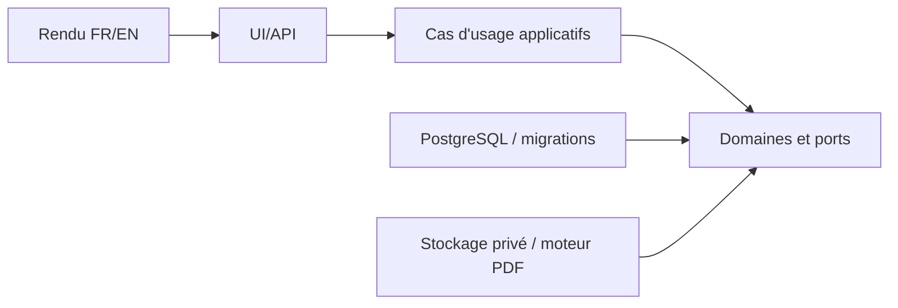
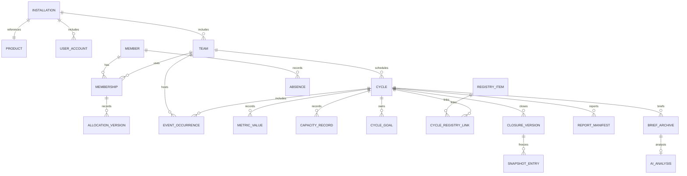

# SMN — Annexe de conception technique

**Statut :** proposition technique alignée sur les décisions utilisateur, non implémentée. **Référence normative :** [spine](ARCHITECTURE-SPINE.md), PRD final et D-PRD-130/131. **Attention :** les schémas et signatures ci-dessous sont des contrats de conception, non du code existant. Versions des dépendances non vérifiées sans recherche autorisée/POC.

## 1. Frontières, propriété et flux d'écriture

| Module logique | Source de vérité et opérations possédées | Interfaces consommées |
| --- | --- | --- |
| Installation/Identité | Installation unique, produit/mode fixes, comptes, rôles et sessions | Audit, configuration privée |
| Organisation | Équipe, rôle agile, affectation temporelle, vision/Product Goal/DoD/DoR | Identité, membres |
| Membres/Calendriers | Membre central, pays/zone, jours ouvrés, absences, fériés, fermetures, versions datées | Organisation |
| Cycles/Événements | Cycles et transitions, génération unitaire/lot, modèles/occurrences, replanification | Calendrier, organisation |
| Métriques/Capacités | Sources SP/flux, objectifs, calculs et références JH, gel initial | Membres, calendriers, cycles |
| Registres | Risques, obstacles, dépendances, décisions, actions, faits marquants, associations multi-cycles | Cycles, équipes |
| Historique/Clôture | Historique des valeurs, audit métier, snapshots Vn associés à une clôture | Sources possédées ci-dessus |
| Restitution/IA | Préparation collective, manifeste, HTML/PDF, briefs TXT, analyses | Interfaces de lecture des propriétaires |

Les modules ne peuvent modifier une entité d'un autre module par un accès SQL parallèle. Les transactions transverses sont coordonnées par un **cas d'usage unique** ; les repositories partagent la même transaction. Une transaction PostgreSQL ne couvre pas automatiquement les fichiers du système d'exploitation.

### Sens des dépendances



La logique métier s'exécute côté serveur pour les opérations de sauvegarde. Une prévisualisation calculée dans l'UI est informative ; elle ne donne pas le droit d'écrire.

## 2. Conception PostgreSQL

### 2.1 Agrégats et relations indicatives



Chaque entité permanente possède un identifiant technique stable, un périmètre d'installation/équipe justifié et les métadonnées d'audit pertinentes. **Le nom affiché d'un cycle n'est jamais utilisé comme clé** : doublons de nom autorisés. Le produit/mode ne changent pas dans une installation ; une nouvelle installation a son propre identifiant.

- Tables et relations ci-dessus = **noms provisoires**. La normalisation physique et les contraintes SQL précises seront affinées dans les migrations.
- `numeric` pour capacités JH, Story Points et valeurs moyennes exigeant précision ; `integer` pour les compteurs Kanban entiers. Refuser les nombres non finis et arrondis implicites.
- `date` pour jours civils, `timestamptz` pour les instants d'audit, identifiant IANA séparé (`Europe/Paris`, etc.) ; la représentation `timestamptz` n'encode pas elle-même la zone de référence.
- Sur les relations multi-cycles, indexer les couples identifiants ; les suppressions de liens n'effacent pas l'objet central.
- Index/conventions : `(team_id, start_at, end_at)` pour les cycles, `(cycle_id, metric_code)` pour les sources, `(cycle_id, version)` unique pour les clôtures, `(member_id, effective_from)` pour les situations datées.
- Empêcher les chevauchements de cycles sur un même périmètre par recontrôle transactionnel ; une contrainte PostgreSQL d'exclusion de plages peut compléter la validation, sous réserve du type d'intervalle et de la granularité retenus.
- Les champs portant des informations chiffrées doivent distinguer NULL et 0 ; aucune valeur supplétive ne se déclenche sur NULL.
- Les modifications de structures passent par migrations versionnées, sauvegarde avant migration sensible et vérification après application.

### 2.2 Accès concurrent

Toute modification métier comporte un contrôle de version ou une clause de concurrence équivalente. Les transactions de création de lot, replanification, clôture Vn et import utilisent des verrous/contraintes adéquats et une revalidation au moment du commit. Une prévisualisation ne réserve pas définitivement les données. Éviter de maintenir une transaction ouverte pendant que l'utilisateur examine la prévisualisation.

**Clôture :** verrouiller cycle et version courante ; vérifier statut et droits ; lire les liens et états des six registres dans un instantané transactionnel cohérent ; créer `CLOSURE_VERSION` et toutes `SNAPSHOT_ENTRY`, puis mise à jour du cycle et audit en une transaction. Unique `(cycle_id, version)`. Deux clôtures concurrentes ne réussissent pas toutes deux sur la même version.

**Import :** valider le fichier entier avant choix utilisateur, produire le comparatif, puis à confirmation relire les états/verrous et appliquer toutes les écritures autorisées en une transaction, sans commit partiel. Les tentatives refusées peuvent figurer dans un journal d'opération mais pas comme import métier réussi.

## 3. Contrats de temps, disponibilités et capacités

### 3.1 Types

| Concept | Représentation/contrat |
| --- | --- |
| Jour travaillé / férié / absence journalière | date civile locale + provenance + référence pays/membre |
| Horaire récurrent | heure locale + zone IANA + règle de récurrence |
| Début/fin de cycle | bornes métier locales, instants calculés pour comparaison, zone de référence conservée |
| Période technique | intervalle semi-ouvert [startInstant, endExclusiveInstant) |
| Transition | `effectiveAt`, `processedAt`, `triggerType`, `result` |
| Changement de rôle, localisation ou allocation | dates d'effet/version historique et date d'enregistrement |

Le moteur de cadence gère des **semaines et mois civils locaux**, pas des heures UTC fixes. Créneaux locaux inexistants/ambigus aux changements d'heure : traitement explicite, jamais décalage silencieux.

### 3.2 Capacités

`disponibilité nette × affectation équipe × part Développeur × coefficient contribution` en jours/homme, sans conversion des SP vers JH. La disponibilité réelle tient compte des informations effectives connues jusqu'à la date de calcul, sans présumer les périodes futures.

- Référence automatique et valeur retenue séparées ; valeur saisie manuellement (y compris 0) prioritaire.
- À l'ouverture effective du cycle ordinaire, figer le prévu initial retenu et sa provenance ; ne jamais l'écraser automatiquement.
- Pour un Sprint historique créé après son terme : aucune cérémonie ou capacité ancienne créée automatiquement. Prévu initial **connu / estimé / non renseigné** exclusivement avec preuve/saisie volontaire ; période historique et date de saisie distinctes.
- En cas d'arrêt de SMN au moment de l'ouverture : conserver la date de transition théorique, l'instant du rattrapage et les versions de données utilisables **connues à l'ouverture**. L'absence de preuve n'autorise aucune photographie fabriquée. La reprise n'a pas de tâche permanente exigée lorsque le PC est arrêté.
- Fériés nationaux, fermetures et absences sont normalisés en **union des indisponibilités** pour éviter les déductions doubles. Calendriers nationaux initiaux France/Allemagne/Royaume-Uni sur N-2 à N+1 si fichiers fournis, catalogue de sept pays ; années manquantes signalées ; particularités régionales = absences individuelles.
- Réunion exceptionnelle ponctuelle : toggle d'impact désactivé par défaut. Si activé, chevauchement des plages travaillées si connues, sinon prorata d'affectation ; déduction plafonnée. **Tenue** utilise durée réelle ; **Non tenue/Annulée** ne réduit pas la capacité réelle ; cérémonies standard/récurrentes sans incidence.
- Référence 8 h/JH par défaut modifiable par équipe ; versionner les paramètres pour audit.

### 3.3 Calculs sources et dérivés

| Mode | Sources enregistrées | Dérivés |
| --- | --- | --- |
| Scrum | `sp_initial`, `sp_added`, `sp_removed`, `sp_completed` (codes illustratifs, catalogue à figer) | engagement final = initial + ajoutés − retirés ; non terminés = final − terminés ; taux = terminés/final ×100 si final>0 |
| Kanban | commencés, throughput, WIP final, Cycle Time moyen, Lead Time moyen | tendances comparables des sources de la période ; aucune dérivation depuis des tickets individuels au MVP |

Les métriques Kanban de durée moyenne sont consignées comme durées en **jours calendaires** (et non jours ouvrés). Aucun WIP ne se déduit par différence des entrées/sorties sans WIP initial.

**Scrum terminé > engagement final** est valide et non bloquant : conserver le dérivé algébrique négatif pour non terminés, afficher éventuellement un **surplus de 4 SP** plutôt qu'un faux « arriéré négatif » et ne pas plafonner un taux de 112,5 %. Un avertissement reste non bloquant. Ne jamais remplacer une source manquante par 0.

Toutes les tendances maximisent **cinq cycles clôturés comparables**, bornés au cycle examiné ; pas d'inclusion de futurs cycles historiques, interpolation ou conversion artificielle.

## 4. Cycles et événements : règles d'orchestration

**Scrum :** 1–4 semaines, défaut deux ; lundi 09:00 → vendredi dernière semaine 18:00 par défaut ; Sprint Planning début ; pas de Daily le premier jour si Planning ce jour ; Daily 09:00 sur jours travaillés ; Review puis Rétro positionnées depuis la fin avec marge 30 min et pause déjeuner 12:00–13:00 configurable. Un événement peut posséder plusieurs segments horaires sans devenir plusieurs événements métier.

**Kanban :** cadence hebdomadaire 7 jours, bihebdomadaire 14 jours ou mois civil complet du premier au dernier jour (**défaut mensuel**) ; génération toujours à la demande, unitaire ou lot ≤6.

**SAFe futur :** génération max trois PI et règles ART en v1.0, sans écran ART dans le MVP.

**Génération :** X=1 création simplifiée avec dates recalculées ; X>1 aperçu + confirmation obligatoire, refus de tous les cycles si un seul chevauchement/invariant échoue ; identifiants stables, noms personnalisables même identiques.

**Replanification :** récapitulatif avant/après, options conserver par défaut ou proposer recalcul, copie d'événements futurs automatiquement générés non personnalisés seulement ; événements `Tenue/Non tenue/Annulée` et historiques strictement protégés ; objectifs, KPI sources, risques/dépendances restent rattachés. Écriture atomique du cycle, des déplacements autorisés, des références recalculables et de l'audit.

## 5. Versions, provenance et récupération de l'histoire

Les données courantes ne constituent pas une photographie exacte du passé. Pour les révisions, distinguer `effectiveAt`, `recordedAt`, `observedAt` si connu, origine `manual|csv|calculated`, qualité `known|estimated|unreported` lorsque pertinente, auteur connu, ancienne/nouvelle valeur et version.

**Clôture Vn :** à chaque clôture réelle d'un cycle, instantané indépendant des fiches centrales des six registres et de leurs liens du moment. Dernière Vn pour nouveau bilan d'un cycle clôturé ; données courantes pour cycle rouvert ; anciennes Vn et anciens PDF inchangés.

**Recalcul sélectif :** un KPI dérivé recalculé n'autorise aucune modification des métriques sources ; corriger une source de cycle clôturé exige la réouverture. FR-14 : aucune correction de capacité d'un cycle clôturé sans réouverture ; la simple actualisation d'un affichage de dérivés n'écrase pas le gel.

**Historique partiel :** une reprise de Sprint terminée, absence d'ancienne photographie et provenance non prouvée sont présentées comme telles. En Kanban, import sur cycles existants au MVP ; création rétrospective complète en réserve A9.

## 6. Contrat CSV et journalisation

```csv
cycle_id,metric_code,value,quality
SPRINT-001,sp_completed,36,known
```

Exemple non contractuel pour les codes. Colonnes **exactement quatre** ; UTF-8 BOM optionnel recommandé, séparateur virgule/point-virgule détecté ou choisi sans ambiguïté, numération décimale documentée, modèle CSV téléchargeable. Une ligne invalide, un cycle absent, un doublon `(cycle_id,metric_code)`, un code mode incompatible ou une qualité non `known|estimated` rejette le fichier entier. Une valeur `0` explicite est valide. En cas de source existante, conservation par défaut ; correction après sélection explicite, comparaison avant/après et contrôle de statut. Import sur cycle clôturé exige réouverture.

Journal d'opération : tentative/prévisualisation/annulation/échec/validation, auteur, heure, identifiant du lot, lignes lues/appliquées/conservées/rejetées, erreurs et liens de révision. Le stockage du CSV brut original **n'est pas imposé**.

## 7. Contrat de restitution et stockage

1. `ReportSelection` décide des sections et périmètres, soumis à habilitation.
2. `DocumentReadModel` réunit données collectives, objectifs, calculs, dates, qualité, registres Vn ou courants et analyses choisies ; aucune rédaction métier fictive.
3. `GenerationManifest` garde les références des données, révisions, snapshot Vn, état du cycle, timestamp et modèle utilisés.
4. `RenderPackage` temporaire constitue le contenu exact validé en aperçu HTML puis utilisé pour PDF ; la pagination peut varier, pas les données. L'export reste à la demande, moteur PDF local à prouver.
5. `BriefContent` : TXT plat sans graphique, données individuelles exclues **avant** la création du document ; texte libre revu avant finalisation. Archive du TXT exact, immuable et privée, duplication avec parent.
6. `Analysis` : humaine ou IA, retouche identifiée ; une seule analyse IA active par brief, réponse copiée manuellement ; ancien TXT non modifié. Les anciennes analyses IA sont exclues par défaut des nouveaux briefs.
7. HTML/PDF et TXT consultables/téléchargeables par **utilisateurs authentifiés et autorisés** ; aucune URL statique anonyme.
8. Rapport standard six sections (synthèse, objectifs, indicateurs/tendances, événements, points d'attention, décisions/actions), sections masquables/réordonnables ; vision/Product Goal en option, DoD/DoR facultatives en fin de document. FR/EN pour libellés, textes libres non traduits.

**Important :** archive TXT obligatoire ; archivage systématique PDF = A10 non décidé. Les mécanismes de relecture des documents doivent être compatibles avec les autorisations d'AD-8 et AD-31, y compris le téléchargement par le Lecteur.

## 8. Contrats API de haut niveau (non routage imposé)

| Cas d'usage | Entrée métier | Sortie/garantie |
| --- | --- | --- |
| `generateCycles` | mode, équipe, date départ, X, configuration et version | IDs de cycles + audit, atomique |
| `replanCycle` | cycle ID, nouvelles bornes, option événements, version, confirmation | cycle/événements/capacités/audit mis à jour ensemble |
| `closeCycle` | cycle ID, version attendue | nouvelle Vn + clôture + audit, atomique |
| `reopenCycle` | cycle ID, raison facultative | état Terminé, Vn conservées |
| `saveMetricsBlock` | cycle ID, métriques sources, version | enregistrement du bloc seul et révisions ; aucun changement aux autres blocs |
| `previewImport` | fichier CSV, identifiant d'installation | aperçu/erreurs, aucune écriture métier |
| `commitImport` | référence d'aperçu, remplacements volontaires, version attendue | transaction totale ou refus |
| `renderReport` | cycle, modèle, choix/autorisation | paquet HTML/PDF cohérent et manifeste |
| `archiveBrief` | contenu TXT final approuvé + contrôle confidentialité | texte exact archivé immuable, ID stable |
| `reconcileTime` | instant de référence et état durable | transitions idempotentes, historiques protégés |

Ces opérations impliquent autorisation serveur et journal adapté ; **l'API HTTP précise et son chemin restent hors du contrat à ce stade**.

## 9. Points encore à éprouver

- Propriété des tokens/session, stratégie CSRF et HTTPS distant ; dérivation de mot de passe et gestion de clés.
- Pilote PostgreSQL et ORM (Prisma/Drizzle candidats), contraintes d'exclusion, stratégie migratoire et jeux de données.
- Next.js/React et export PDF local sans administrateur ni Docker ; starter et versions à vérifier.
- Sauvegarde/restauration cohérente, accès PostgreSQL sans superuser et publication contrôlée de documents.
- Rôles : AD-31 rapproche la validation ultérieure à trois profils (Administrateur / Opérateur / Lecteur) avec l'ancien profil Utilisateur, devenu Lecteur ; ce dernier conserve le téléchargement de documents autorisés. Les droits de l'Opérateur sur les données individuelles restent à préciser avant les Stories concernées.
- A5/A7/A8/A9/A10/A11/A12, sans modification des décisions métier antérieures.

Voir [sécurité et exploitation](SECURITE-EXPLOITATION.md) et [revue/traçabilité](REVUE-COHERENCE-TRACABILITE.md).
