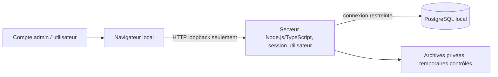

# SMN — Sécurité, installation, exploitation et continuité

**État :** annexe de conception, pas de procédure effectivement exécutée sur le PC de l'utilisateur. Les détails de sécurité, versions et seuils NFR seront vérifiés en POC I0 et recette I6. Documents sources : PRD FR-66–73, FR-74–81, D-PRD-128/129, [architecture spine](ARCHITECTURE-SPINE.md).

## 1. Topologie d'exécution

### MVP sur PC personnel



- Le serveur de SMN ne doit pas écouter sur toutes les interfaces réseau par défaut ; initialiser le premier administrateur via une procédure à usage unique limitée à la machine locale.
- Une utilisation sur smartphone/tablette depuis un autre appareil exige une exposition réseau **délibérée et protégée** ; elle ne découle pas de l'écoute en loopback.
- Le fonctionnement ne doit pas imposer les droits administrateur Windows, l'installation d'un service Windows, Docker, un IDE ou la CLI Codex. L'utilisateur dispose de Node.js, npm/pnpm, PowerShell et d'un PostgreSQL déclaré opérationnel.
- La disponibilité d'un binaire PostgreSQL ne garantit pas l'accès aux outils `pg_dump` / `pg_restore`, le privilège de création de base ou la compatibilité des versions : les vérifier séparément.

### Hébergement web éventuel (non MVP)

Proxy HTTPS avec durcissement réseau, serveur Node, PostgreSQL accessible uniquement côté serveur, stockage privé et politique multiutilisateur. Une évolution hébergée exigera de nouveaux tests de charge, de sécurité, de droits par périmètre et éventuellement de cloisonnement des installations ; **le MVP local ne constitue pas un SaaS multi-tenant**.

## 2. Authentification, rôles et première installation

### 2.1 Règles approuvées avant rédaction

- Anonymat autorisé seulement pour l'assistant de création d'une **installation vierge** ; aucune page, donnée métier ni fichier privé ne doit être consultable anonymement.
- Première installation : création sûre et atomique de l'administrateur ; en cas de démarrage concurrent, une seule initialisation est retenue. Une installation finalisée ne réexpose jamais cet assistant.
- L'identifiant d'amorçage préalablement enregistré dans le journal est `admin@locahost.com` (**orthographe conservée telle que décidée**) ; secret temporaire jamais documenté en clair, changement requis avant utilisation métier. Ce compte ne peut être réinitialisé silencieusement par une mise à jour.
- Formulaire de création des comptes et attribution du rôle dans l'administration **dès le MVP**. Les comptes applicatifs ne représentent pas automatiquement les équipiers.
- La décision historique AD-8 définissait **Administrateur** et **Utilisateur**. **AD-31 a été corrigé ultérieurement par D-PRD-136** : deux profils au MVP, **Administrateur** (Scrum Master) et **Utilisateur**. Ce dernier consulte les collectifs et télécharge les documents autorisés sans édition. La proposition à trois profils reste une étape historique, pas une règle MVP.
- L'**Administrateur** gère les cycles, métriques, bilans, registres et données individuelles. L'**Utilisateur** est limité à la lecture collective et aux téléchargements de documents autorisés : aucun droit individuel, de modification, ni moteur de périmètres complexes au MVP. Voir les [arbitrages validés](../../prds/prd-SMN-2026-10-18/arbitrages-metier-valides-2026-10-19.md).
- La **génération** d'un nouveau rapport/brief reste réservée à l'**Administrateur** ; l'Utilisateur peut consulter et télécharger les documents déjà autorisés.

### 2.2 Contrôles côté serveur

| Ressource/action | Vérification |
| --- | --- |
| Page et API métier | Session authentifiée valide, installation et périmètre |
| Lecture des métriques collectives | Autorisation de consultation |
| Absences nominatives, coordonnées, capacités individuelles | Autorisation renforcée |
| Modification des cycles, registres et métriques | Permission de modification + protection état cycle |
| Administration/comptes/sauvegardes | Permission administrateur |
| Rapport HTML, PDF, TXT | Session, autorisation documentaire, ressources non publiques |
| Initialisation | Jeton d'amorçage/accès local, installation vierge, transaction et désactivation après succès |

Cookies de session `HttpOnly` et `SameSite`, attribut `Secure` dès HTTPS, renouvellement/révocation, expiration et protections CSRF pour les mutations. Contrôler également les identifiants de ressources demandés (prévention d'accès direct non autorisé), les téléchargements et les accès aux pièces privées.

Les mots de passe exigent un schéma de dérivation résistant avec sel individuel et paramètres versionnables, comparaison sécurisée, limitation des essais et récupération d'accès administrateur contrôlée sans backdoor. Algorithme et paramétrage à sélectionner et éprouver.

### 2.3 Données sensibles et chiffrement

**Séparer les secrets du code et de la base.** Aucun mot de passe, token, clé réelle ou configuration personnelle dans GitHub, logs ou documents de recette.

Le chiffrement applicatif authentifié ciblé des **coordonnées et motifs d'absence** fait partie des principes approuvés ; il faudra spécifier l'emplacement de la clé, sa rotation, le déchiffrement lors des sauvegardes/restaurations et le devenir des données dans révisions/snapshots. **Ne pas affirmer que ce chiffrement ciblé protège tous les textes libres** ou qu'il remplace la sécurité du poste/disque.

Les rapports HTML/PDF excluent par défaut les données individuelles inutiles ; les briefs TXT excluent **structurellement** tout champ individuel de membre avant rendu. Les commentaires libres nécessitent validation humaine explicite de confidentialité avant archivage TXT, sans transfert automatique à une IA externe.

La conformité légale et les éventuelles mesures d'anonymisation/suppression (A11) demandent un arbitrage produit/sécurité avant pilote, particulièrement pour historiques et backups.

## 3. Installation guidée PostgreSQL

Proposer au premier lancement :

1. Vérifier présence de Node.js, paramètres du serveur applicatif et capacité d'écoute locale.
2. Vérifier connectivité de PostgreSQL, version disponible, droits du compte de déploiement et configuration TLS si distante.
3. Utiliser une base dédiée SMN, créée au préalable ou par l'assistant **uniquement si les droits l'autorisent** ; jamais supposer qu'un compte d'application dispose de privilèges serveur.
4. Appliquer les migrations dans une transaction ou séquence fiable, avec version du schéma et journal ; prévoir un état d'échec bloquant au lieu de poursuivre avec tables incohérentes.
5. Créer l'installation (mode Scrum ou Kanban, produit unique, équipe initiale) et le compte administrateur selon parcours Express/Guidée/Tutorée ; figer le mode et produit.
6. Fermer le parcours anonyme, établir les premières sessions seulement selon les règles de changement de secret.
7. Vérifier un démarrage/arrêt/redémarrage sans intervention en SQL.

**Permissions PostgreSQL :** distinguer si nécessaire un compte migrateur et un compte runtime à droits limités. Secrets de connexion stockés hors Git ; aucun fichier `.env` réel publié.

**Choix de bibliothèques :** Next.js/React, ORM et outil PDF candidats, versions non arrêtées ; valider l'installation sur Windows avec les binaires disponibles. Aucune recherche web avancée n'a été effectuée ou autorisée durant cette rédaction.

## 4. Stratégie de sauvegarde PostgreSQL

### 4.1 Contenu et consistance

Doivent pouvoir être sauvegardés : base et migrations, données métier, historiques, instantanés Vn, comptes et paramètres non secrets, TXT archivés et fichiers conservés par SMN. Un document PDF qui n'a jamais été archivé dans SMN n'est pas inclus fictivement.

Préférer les mécanismes natifs PostgreSQL (par exemple `pg_dump` dans un format compatible avec `pg_restore`) avec contrôle des versions des outils et des permissions. `pg_dump` produit une photographie logique transactionnellement cohérente de la base ; **cela ne suffit pas à synchroniser des fichiers externes à la base**. Pour ces derniers : séquence de gel/manifest ou stockage versionné avec procédure explicite, puis contrôle des références.

### 4.2 Manifeste

```text
backup-id ; timestamp UTC ; source-installation ; version-app ;
schema-version ; PostgreSQL-source-version ; liste-composants ;
empreintes SHA-256 ; état vérifié ; format de restauration
```

Le manifeste seul n'établit pas que la sauvegarde est restaurable. Chaque scénario de recette doit inclure **une restauration vers une base et un emplacement de test distincts**, vérification des relations, des archives et comparaison d'un jeu de données connu.

### 4.3 Rétention et protection

- Les archives et copies ne doivent pas être publiées ou accessibles par URL statique.
- Chiffrer les sauvegardes ou protéger fortement leur lieu de stockage selon le modèle de menace final, surtout si exportables/hors machine.
- Les secrets ne doivent pas figurer en clair dans une archive partageable ; prévoir une stratégie de réinitialisation et de sauvegarde des clés adaptée.
- La restauration destructive est réservée à l'administrateur et nécessite aperçu des impacts, confirmation et audit ; conserver si possible un point de sauvegarde préalable.
- L'utilisateur peut créer une sauvegarde manuelle ; sauvegarde automatique et vérification à la reprise sont recommandées, **pas encore imposées** par la décision fonctionnelle.
- RPO 24 h et RTO 60 min ont été proposés comme **cibles indicatives non validées** ; ils ne sont pas garantis par la sauvegarde manuelle et doivent être mesurés sur jeu de données/équipement de référence.

## 5. Migrations et versions

- Migrations PostgreSQL versionnées, testées sur données représentatives et avec procédures explicites pour migrations non réversibles.
- Vérifier version de schéma au démarrage ; éviter de servir l'application si migrations obligatoires en échec.
- Sauvegarde cohérente préalable pour évolution sensible, puis contrôle d'intégrité ; ne pas promettre un rollback automatique de toute migration.
- Pinning des versions de runtime, dépendances et moteur de rendu après vérification de compatibilité ; aucune version actuelle inventée.
- Les anciens PDF et TXT immuables ne sont pas reconstruits lors d'une migration.

## 6. Documents et sécurité des rendus

HTML et PDF reposent sur un modèle documentaire typé commun ; la conversion PDF doit être locale et **ne jamais transférer les textes privés vers un SaaS de conversion**. Interdire l'accès arbitraire du renderer aux chemins locaux, fichiers secrets et URLs distantes non approuvées ; assainir les contenus HTML, borner les ressources et les temps d'exécution.

Le paquet d'aperçu/export conserve un manifeste des données résolues et un identifiant temporaire autorisé ; supprimer les fichiers temporaires à l'expiration/échec. Ne pas qualifier une prévisualisation comme PDF archivé. **A10 est validé** : tout export réussi produit une archive PDF privée finale, liée au manifeste, sans purge automatique par ancienneté.

**TXT IA :** stocker préférentiellement le contenu final exact dans PostgreSQL avec empreinte et métadonnées, comme une archive non modifiable. La consultation et le téléchargement appliquent le contrôle de droits. L'analyse éventuellement collée ensuite est distincte, modifiable selon la règle métier, sans changer le TXT.

## 7. Résilience et traitements différés

Séparer **date métier d'effet** et **date du traitement réel**. À l'ouverture/redémarrage, un cas d'usage réconcilie les transitions de cycles et événements dues pendant l'arrêt, de façon idempotente et en vérifiant toute suspension manuelle. Les capacités initiales ne sont jamais reconstruite à partir d'absences et affectations enregistrées après leur ouverture ; marquer indisponibilité de preuve si nécessaire.

Les imports, clôtures, replanifications et créations de lots atomiques ne doivent jamais annoncer un succès avant confirmation effective de la transaction. Pour un rendu PDF, un fichier incomplet ou un document absent ne doit pas être annoncé comme livré.

### Trois journaux

| Journal | Périmètre | Protection |
| --- | --- | --- |
| Audit métier | opérations, révisions, auteur, versions, avant/après justifiés | contrôle de consultation ; pas de faux succès |
| Sécurité | tentatives de connexion, accès refusés, opérations administratives | pas de mots de passe, secrets ou contenu libre confidentiel |
| Technique | erreurs runtime, DB, rendus, reprise, migrations | corrélation opération/erreur sans dump automatique de données privées |

Aucune collecte exhaustive des clics/navigation n'est requise. La conservation des journaux demeure soumise aux choix A11/NFR.

## 8. Tests de sécurité et disponibilité : critères de preuve

| Test | Preuve requise |
| --- | --- |
| Installation vierge et double demande concurrente | un seul administrateur créé, accès anonyme fermé après succès |
| Accès URL directe document sans session | refus serveur, aucun octet confidentiel livré |
| Accès utilisateur à absence individuelle | refus ; téléchargement du document explicitement autorisé possible |
| Session expirée/révoquée | action et téléchargement refusés |
| Injection dans description/nom de risque | données inertes dans UI/PDF, pas de script exécuté |
| Secret de connexion | absent du Git, journaux et exports |
| Double clôture simultanée | une seule transition valide, Vn sans doublon |
| Panne au milieu d'un import | aucune écriture métier partielle |
| Redémarrage après début de Sprint | transition reprise, capacité initiale prouvée ou indisponible |
| `pg_dump` et restauration test | données, liens, Vn, TXT archivés cohérents |
| Migration interrompue | état détecté ; aucune application prétendue saine |
| Génération PDF locale | même contenu métier que prévisualisation validée |

## 9. NFR proposés à confirmer (A5)

| Dimension | Cible indicative non engagée | Condition de validation |
| --- | --- | --- |
| Affichage courant | p95 ≤ 2 s | équipement, volume, connexion de référence fixés |
| Mutation simple | p95 ≤ 2 s | protocole et point de mesure documentés |
| PDF taille standard | ≤ 30 s | pages, graphiques, moteur et matériel définis |
| Accessibilité | viser WCAG 2.2 AA | périmètre, tests automatiques et manuels |
| Navigateurs | Edge/Chrome/Firefox + mobile | versions minimales et matrice d'appareils |
| RPO/RTO | 24 h / 60 min indicatifs | sauvegardes réelles, interruptions et restauration mesurées |
| Sécurité | aucun accès direct non autorisé | scénarios positifs/négatifs et audit des vulnérabilités |

Ces seuils ne changent pas les **cinq conditions métier déjà validées** du passage au pilote, notamment rapport complet en moins de 30 minutes et saisie courante plafonnée à 30 minutes/semaine.

## 10. Réserves / séquence des vérifications

1. **Avant Stories I0 des accès :** appliquer les **deux profils Administrateur/Utilisateur** validés en D-PRD-136 ; définir récupération du compte administrateur et secret initial hors documentation.
2. **Pendant I0 :** valider PostgreSQL accessible sans privilèges Windows supplémentaires, migrations, sécurité des sessions, bundling Next.js/Node et rendu PDF local ; mesurer un cas représentatif.
3. **Pour les Stories concernées :** A7/A8/A10/A11 sont **définis fonctionnellement** par D-PRD-132 à 135 ; concevoir et tester leurs mécanismes, sans supposer la conformité ou la réussite technique.
4. **Avant pilote :** A5 performance/accessibilité/RPO/RTO ; A12 tests temporels des rapports ; séquences d'arrêt/reprise ; cinq critères de succès métier cumulés avec preuves.

Aucune opération sur PostgreSQL, aucun script `pg_dump`, aucun test Windows, aucune mise à jour de dépendance et aucune validation de sécurité n'ont été exécutés dans cette session.

## Addendum — Décisions finales D-PRD-134 à 136

A10 : archives PDF privées automatiques pour exports réussis, cohérence base/fichiers, immuabilité des archives conservées et suppression exceptionnelle contrôlée. A11 : procédures de suppression/anonymisation justifiées, impact sur archives et snapshots, **30 jours de conservation par défaut des sauvegardes gérées**, interdiction de réintroduire silencieusement une personne effacée lors d'une restauration. AD-31 : deux rôles MVP uniquement, **Administrateur (Scrum Master) et Utilisateur (lecteur collectif, téléchargement autorisé)** ; aucune habilitation complexe pour le MVP. La revue juridique et les tests d'intégrité/restauration restent ouverts. [Décisions et critères](../../prds/prd-SMN-2026-10-18/arbitrages-metier-valides-2026-10-19.md).


## D-PRD-138 — Durée des sessions MVP

**19 octobre 2026 à 22:19 (Europe/Paris) — politique explicitement validée par l'utilisateur.**

- Durée absolue maximale : **8 heures** depuis la connexion. Une nouvelle authentification est requise à l'échéance, même si la personne est active.
- Expiration après **30 minutes d'inactivité utilisateur** ; les requêtes de fond ne constituent pas à elles seules une activité de la personne.
- **Aucune option « Se souvenir de moi » au MVP.**
- Contrôle côté serveur ; les refus et garanties de confidentialité existants restent applicables. La protection des brouillons reste celle du PRD ; cette politique n'introduit pas d'enregistrement automatique implicite.

S'applique aux deux profils MVP sans nouveau rôle. Complète FR-66/67 et les garanties AD-7/26/31 ; [SMN-14](https://lmn24.atlassian.net/browse/SMN-14) porte les critères correspondants. La validation de ces durées ne finalise ni le choix de Better Auth ni la procédure de récupération administrateur. Aucun développement, essai d'expiration ou résultat de sécurité attesté.


## D-PRD-139 — Récupération locale du compte administrateur MVP

**19 octobre 2026 à 22:23 (Europe/Paris) — principe explicitement validé par l'utilisateur.**

En cas de mot de passe administrateur oublié, une commande locale fournie avec SMN permet de définir un nouveau mot de passe, avec saisie masquée, sans installer d'outil supplémentaire ni demander une modification SQL manuelle. La récupération vise le compte administrateur existant : elle ne crée aucun second administrateur et ne dépend pas d'un envoi d'e-mail. Après réussite, toutes les sessions de ce compte sont révoquées ; une trace est conservée sans le mot de passe.

**Limite de la validation :** le mécanisme de contrôle du propriétaire de l'installation, les protections de la commande, la cohérence transactionnelle du renouvellement/révocation et les modalités de reprise restent à concevoir et à tester. La seule présence sur le poste ou une requête loopback ne constitue pas une preuve d'autorisation ; aucun bouton ou endpoint anonyme de récupération n'est introduit. Pas de mot de passe en argument de commande, dans Git ou dans les journaux.

Complète FR-66/67/70/72 et AD-7/9/10/26/31 ; [ticket de référence](https://lmn24.atlassian.net/browse/SMN-17). Les deux profils, la politique de session D-PRD-138 et le produit fixe restent inchangés. La récupération d'accès ne doit pas prétendre récupérer automatiquement les clés de chiffrement perdues. Aucun développement ni essai de récupération exécuté.
