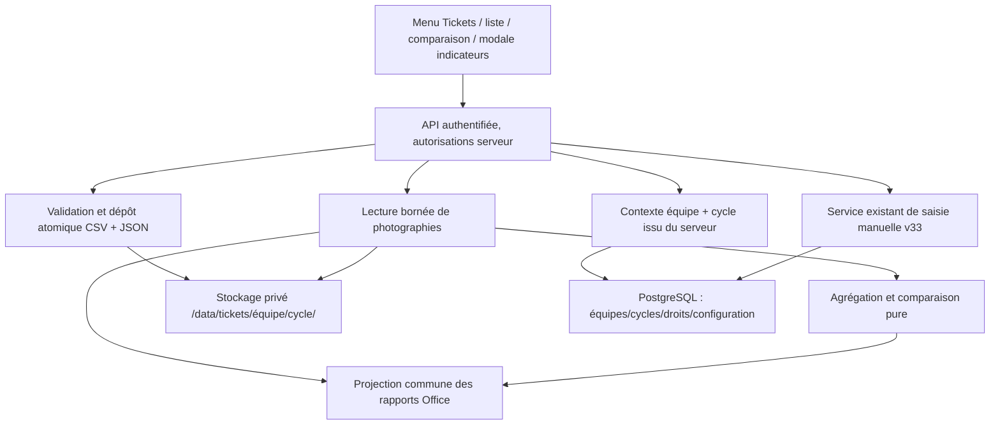

# Architecture Spine — Tickets CSV historiques (SMN)

> Extension de l'architecture existante, **sans renumérotation ni remplacement** des AD du projet. Les décisions ci-dessous fixent les frontières communes aux futurs incréments ; elles ne constituent ni un développement ni une recette. Les éléments marqués **[ADOPTED]** découlent du cadrage utilisateur du 13/11/2026. Les décisions complémentaires sont **[PROPOSED]** et devront être vérifiées avant implémentation.

## Paradigme et frontières

**Monolithe modulaire TypeScript ; stockage privé de photographies CSV et métadonnées JSON ; lecture/calcul/comparaison à la demande.** PostgreSQL demeure la source de vérité pour les équipes, cycles, habilitations, configuration Jira et indicateurs v33 existants ; les tickets importés ne sont **jamais** chargés en tables SQL.

## Invariants propres à cette fonctionnalité

### TCK-AD-1 — Une photographie datée, pas un import métier SQL [ADOPTED]
- **Binds:** import, consultation, rapports, sauvegardes.
- **Prevents:** duplication des tickets en base et dépendance à Jira en ligne.
- **Rule:** chaque import validé produit un CSV original et un JSON de métadonnées conservés sur disque, rattachés à un seul identifiant stable d'équipe et de cycle. Les tickets n'ont pas de représentation persistée dans PostgreSQL.

### TCK-AD-2 — Deux temporalités distinctes [ADOPTED]
- **Binds:** upload, historique, comparaison, rapports.
- **Prevents:** confusion entre antidatage métier et horodatage réel.
- **Rule:** le JSON conserve la date métier déclarée et l'horodatage réel d'import. Les comparaisons sont ordonnées par date métier, pas par date de dépôt. Ne jamais falsifier les dates système ou d'audit.

### TCK-AD-3 — Contrat CSV strict et versionné [ADOPTED]
- **Binds:** validation, analyse, export.
- **Prevents:** interprétations divergentes d'un fichier entre écran et rapport.
- **Rule:** une seule définition contractuelle de colonnes et types, versionnée ; tout CSV non conforme est rejeté avant dépôt définitif. Le schéma exact, les valeurs de statut et les limites sont des décisions ouvertes.

### TCK-AD-4 — Contexte et autorisation côté serveur [ADOPTED]
- **Binds:** menu, API, import, consultation, téléchargement, suppression, rapports.
- **Prevents:** lecture transversale entre équipes/cycles ou contournement des droits par URL.
- **Rule:** le cycle présélectionné provient du contexte du header et est validé sur le serveur avec l'équipe active et les permissions. Aucun chemin filesystem n'est construit depuis un nom de fichier ou un identifiant fourni sans vérification.

### TCK-AD-5 — Une source de calcul et comparaison [ADOPTED]
- **Binds:** liste de tickets, totaux, regroupements, rapports.
- **Prevents:** écarts de résultat entre interface et exports.
- **Rule:** parser, normaliser et agréger en services de domaine purs ; identifier les tickets par clé Jira ; comparer deux photographies d'un même cycle, ancienne puis récente, sans fusionner leurs totaux. Les règles précises de statut « terminé » restent configurables ou à valider.

### TCK-AD-6 — Indicateurs v33 exclusivement manuels [ADOPTED]
- **Binds:** modale Indicateurs et moteur v33.
- **Prevents:** alimentation ou écrasement automatique d'indicateurs depuis un CSV.
- **Rule:** la modale appelle uniquement la saisie manuelle existante avec contrôles d'autorisation, révisions et rattachement au cycle. Aucun résultat de calcul CSV ne déclenche une création, modification ou recalcul d'indicateur v33.

### TCK-AD-7 — Rapports lisant la même photographie [ADOPTED]
- **Binds:** rapports Word/PowerPoint et lecture Tickets.
- **Prevents:** changement silencieux d'un rapport lié à une autre version de CSV.
- **Rule:** toute projection de rapport identifie explicitement la photographie source (identifiant, date métier, empreinte) et réutilise les mêmes fonctions de lecture, comparaison et agrégation que l'écran ; aucun moteur Office indépendant ne recalcule ses propres règles.

### TCK-AD-8 — Écriture atomique et traçable [PROPOSED]
- **Binds:** upload, remplacement, sauvegarde, reprise.
- **Prevents:** paire CSV/JSON partielle, collision de dates et corruption en cours d'écriture.
- **Rule:** valider avant toute publication ; écrire en zone temporaire privée ; vérifier intégrité, publier une unité logique complète puis lister uniquement les unités validées. Ne jamais écraser silencieusement une photographie existante.

### TCK-AD-9 — Données privées préservées par la distribution [PROPOSED]
- **Binds:** distribution Windows, mise à jour, sauvegarde/restauration.
- **Prevents:** perte d'historique lors du transfert sur un autre PC.
- **Rule:** données sous le répertoire de données de l'installation SMN, hors payload de mise à jour applicative ; inclure CSV et JSON dans la sauvegarde/restauration utilisateur sécurisée, avec vérification d'intégrité et restauration cohérente. L'intégration précise dépend de l'API de restauration existante.

### TCK-AD-10 — URL Jira configurable sans authentification distante [ADOPTED]
- **Binds:** Paramètres, affichage et exports.
- **Prevents:** URLs Jira construites arbitrairement ou appels réseau lors de l'import.
- **Rule:** une URL de base Jira validée côté serveur permet de construire `/browse/<clé>` ; l'existence effective du ticket n'est pas contrôlée par API Jira dans le périmètre initial.

## Seed (réalité observée, non normative)

- Navigation : `src/lib/private-navigation.ts`, `src/app/app/private-shell.tsx`.
- Validateur CSV historique existant, **non réutilisable tel quel** : `src/lib/historical-csv-validator.ts`.
- Projection de rapports : `src/lib/report-data-contract.ts` ; Centre Rapports `src/app/app/reports/`.
- Référentiel UX obligatoire : `docs/UX-REFERENTIEL-BMAD.md` et interface Cockpit Agile ; internationalisation JSON FR/EN.
- Le dossier cible `data/tickets/<teamId>/<cycleId>/` est une **proposition de convention**, pas une structure existante vérifiée.

## Différé — décisions à valider avant découpage définitif

1. Schéma CSV exact, colonnes obligatoires, séparateur et encodage, définition des statuts terminés.
2. Politique de collision de date métier : un CSV unique par date et cycle, remplacement versionné ou plusieurs photographies le même jour.
3. Taille maximale, nombre de fichiers, chargement paginé et volume toléré.
4. Comportement à la clôture/reclôture, suppression et droits spécifiques ; conservation des archives.
5. Définition des champs de comparaison et export des écarts en rapports Office.
6. Emplacement et forme des paramètres d'URL Jira selon équipes/installations.
7. Réconciliation d'une paire CSV/JSON après coupure et procédure de restauration atomique.
8. UX Sally : filtres, modales, sélection des photographies, présentation des totaux.

## Portes de sortie

- Vérifier les contrats actuels du moteur v33, des rapports Office, des permissions et du système de sauvegarde/restauration avant codage.
- Définir les AC couvrant les CSV malformés, clés dupliquées, collisions temporelles, statut terminé/rouvert, sécurité des chemins, droits serveur, reprise après interruption, restauration PC et absence d'écriture v33.
- Exécuter les tests dans l'environnement adapté. **Aucun script uv, lint BMAD, tests ni gate de revue n'a été exécuté pour cette rédaction.**

## Avenant contraignant du 13/11/2026 — TCK-AD-3 / TCK-AD-8 [ADOPTED]

- **TCK-AD-3 (précisé) :** le CSV a **exactement six colonnes métier**, dans cet ordre : `Id jira`, `Type de ticket`, `Titre du ticket`, `Priorité`, `Statut`, `Story points`. Le contrat technique de parsing (séparateur, représentation SP, contraintes de valeurs) reste à détailler sans créer de colonnes métier nouvelles.
- **TCK-AD-8 (précisé) :** unicité de la photographie sur le couple **(équipe, cycle, date métier)**. Sur conflit de date, **confirmation utilisateur obligatoire avant écrasement**, puis remplacement **atomique** de CSV et JSON après validation ; annulation et erreur doivent laisser l'ancienne photographie lisible. L'écrasement ne doit pas être silencieux.
- **Suppression de photographie [ADOPTED] :** action explicite depuis la liste, confirmation Cockpit Agile et suppression cohérente du CSV et du JSON, contrôlée côté serveur par les permissions ; les implications sur l'audit/archives et les sprints clôturés restent à qualifier.

Les points différés n°1 (colonnes principales) et n°2 (collision de date) sont donc **tranchés** par le présent avenant, même si le texte historique de la section « Différé » est conservé pour traçabilité.

## Avenant de décision — 13 novembre 2026 (complément aux précédents)

- **Statuts terminés [ADOPTED] :** dans les calculs et comparaisons CSV, les valeurs **Done** et **Terminé** signifient « terminé ». Ne pas traiter les autres statuts comme terminés sans validation ultérieure ; normaliser les variations de casse et les espaces sans altérer le CSV source.
- **Colonnes [ADOPTED — précision récente] :** conserver comme champs métier les six libellés définis par l'utilisateur (`Id jira`, `Type de ticket`, `Titre du ticket`, `Priorité`, `Statut`, `Story points`), **sans contraintes métier supplémentaires sur les valeurs des colonnes**. Ne pas inventer d'énumérations obligatoires pour type, priorité ou statut. La lecture numérique des Story points et l'extraction des clés Jira sont nécessaires aux analyses, mais une valeur non exploitable n'est pas arbitrairement transformée en zéro. La précédente exigence d'un contrôle rigide d'ordre et de valeurs est **à réconcilier avec cette précision** avant le développement.
- **Suppression [ADOPTED] :** aucune suppression de photographie CSV/JSON depuis un **sprint Scrum clôturé**. L'action est indisponible en interface, et l'API refuse systématiquement la suppression même sur appel direct. Les autres règles de modification de sprint clôturé et le cas des périodes Kanban ne sont pas décidés ici.
