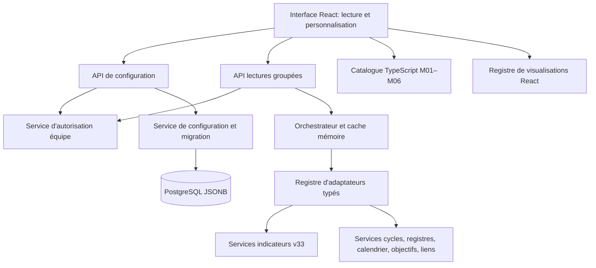

# Dashboard Builder SMN — Dossier d'architecture BMAD

**Auteur :** Winston — System Architect. **Date :** 1er novembre 2026. **Version :** 1.0.
**Statut :** décisions A-DB-01 à A-DB-18 validées en conversation ; architecture cible publiée pour revue technique. Aucun code ni test du Builder exécuté.
**Source métier :** [Spécification fonctionnelle D-DB-01 à D-DB-31](../../dashboard-builder/dashboard-builder-specification-fonctionnelle-v1.md).
**Architecture de référence :** [Architecture Spine SMN](../architecture-SMN-2026-10-19/ARCHITECTURE-SPINE.md).

## 1. Objet et principes

Créer un Dashboard Builder individuel par utilisateur autorisé et par équipe, avec deux blocs d'en-tête configurables, lignes et blocs ordonnés, modèles M01–M06 et emplacements indépendants. Conserver les données et calculs métier dans leurs services propriétaires ; persister seulement les configurations. Ne pas ajouter de microservice, Redis, éditeur libre ou stockage local distinct.

## 2. Registre complet des décisions

| Décision | Choix validé |
|---|---|
| A-DB-01 | Module Dashboard Builder dédié au sein du monolithe SMN |
| A-DB-02 | Persistance hybride PostgreSQL + JSONB par compte et équipe |
| A-DB-03 | Catalogue TypeScript versionné et migrations automatiques sans pertes |
| A-DB-04 | Registre central d'adaptateurs de sources typés |
| A-DB-05 | Registre indépendant de visualisations typées |
| A-DB-06 | Orchestrateur central de chargement progressif et lectures mutualisées |
| A-DB-07 | Autorisations centralisées et vérifiées côté serveur |
| A-DB-08 | Verrouillage optimiste des configurations, détection des conflits |
| A-DB-09 | JSONB hiérarchique avec identifiants stables |
| A-DB-10 | Migrations hybrides sécurisées, contrôle préalable et migration à l'utilisation |
| A-DB-11 | API de configuration séparées des lectures métier groupées |
| A-DB-12 | État React centralisé via reducer et commandes typées |
| A-DB-13 | CSS Grid et bibliothèque spécialisée pour les interactions |
| A-DB-14 | Cache mémoire contextualisé et actualisation adaptative |
| A-DB-15 | Remplacement immédiat de l'ancien Dashboard à la mise en service validée |
| A-DB-16 | Journalisation minimale dans les journaux existants de SMN |
| A-DB-17 | Pyramide de tests adaptée à SMN et recette locale Windows |
| A-DB-18 | Sauvegardes générales SMN et protection transactionnelle des migrations |

## 3. Architecture logique

Le module Builder possède l'arborescence de configuration, mais non les valeurs métier. Les adaptateurs consomment des services de lecture existants. L'interface ne calcule pas les indicateurs et ne lit pas PostgreSQL directement.

## 4. Schéma de persistance cible

Une table conceptuelle `dashboard_configurations` contient `id`, `user_id`, `team_id`, `revision`, `schema_version`, `layout JSONB`, `created_at`, `updated_at`, avec unicité `(user_id, team_id)` et références aux comptes/équipes. Nom exact et relations Prisma/SQL à fixer avant codage.

Arborescence logique : `header.blocks[]` (exactement deux blocs), `rows[]`, `rows[].blocks[]`, `blocks[].slots[]`. Chaque ligne, bloc et emplacement possède un identifiant stable, indépendant de sa position; chaque bloc référence `templateId` et `templateVersion`; chaque slot référence `templateSlotId`, source, vue, filtres et exception de contexte. Les tailles sont logiques et la hauteur `auto` ou fixe. Les valeurs sources ne sont jamais stockées dans le layout.

Trois versions différentes : révision concurrentielle dans PostgreSQL, version du schéma JSONB, version du modèle. Les structures et dimensions sont validées côté serveur, avec rejet des identifiants dupliqués, modèles/slots incohérents, filtres inconnus et références à une équipe non autorisée.

**Enregistrement :** contrôle serveur de l'habilitation puis écriture atomique conditionnée à la révision attendue. Mise à jour réussie => révision incrémentée; échec concurrent => réponse 409 sans effacer le brouillon. Les mises à jour automatiques de modèles respectent cette même protection.

## 5. Catalogue de modèles et migrations

Catalogue TypeScript versionné des six modèles : M01 Simple (1), M02 Duo (2), M03 Trio (3), M04 Quatuor (4), M05 Asymétrique (2 de tailles différentes), M06 Composé (3 dont un large). La structure du modèle est indépendante des contenus. Une version plus récente conserve les références des emplacements et leurs configurations. Les modèles obsolètes sont retirés du catalogue de création mais leurs versions restent rendables pour les dashboards existants.

**Migration hybride :** précontrôle des chemins de migration lors de l'évolution de SMN; transformation en mémoire au premier accès; validation de conservation des éléments configurés; persistance transactionnelle avec révision attendue. Échec => ancienne configuration préservée et ancien rendu compatible si possible. Le changement volontaire vers un modèle plus petit reste distinct : confirmation et retrait des slots excédentaires uniquement dans le brouillon annulable.

## 6. Sources et visualisations

Chaque adaptateur de source déclare : identifiant stable, type de résultat (`numeric`, `series`, `collection`, `business-text`), portée (`team`, `cycle`, cycle explicite), schéma de filtres, présentations compatibles et fonction de lecture sécurisée. Les données passent par les services métier, notamment les contrats v33 pour indicateurs, historiques et snapshots. Une jauge exige une échelle valide; aucun plafonnement métier arbitraire d'un taux supérieur à 100 %.

Chaque visualisation React est enregistrée séparément (`metric-value`, `gauge`, `line`, `bar`, `list`, `table`, `business-text` selon faisabilité) avec contrat de donnée et paramètres. Le registre commun de compatibilité interdit les combinaisons impossibles. Les états `available`, `empty`, `unavailable` et `error` ne sont pas interchangeables; zéro demeure une valeur numérique valide.

## 7. API et sécurité

Deux surfaces API : configuration (`GET`, `PUT`, catalogues) et données (`POST` de lectures groupées). Les chemins précis restent à rapprocher des conventions Next.js du dépôt. Un contexte équipe autorisé est construit depuis session et droits serveur; `teamId` et autres références du navigateur ne prouvent aucun droit. Autorisations de lecture et personnalisation indépendantes : consultation seule => lecture; aucun accès équipe => aucune vue; sauvegarde et duplication vérifiées au serveur. Une configuration privée d'autrui n'est pas accessible. L'accès unifié aux contenus collectifs du Dashboard n'autorise pas la divulgation des données personnelles sensibles.

**Point bloquant identifié :** le résolveur historique `resolveAdminTeam` n'autorise pas les lecteurs non administrateurs et doit être remplacé/étendu pour les équipes autorisées. Cache et résultats ne doivent pas franchir les périmètres compte/équipe/permission.

## 8. Interface React, responsive et édition

État `savedLayout` (version connue), `draftLayout` (commandes reducer: ajouter, déplacer, redimensionner, modifier source/vue, dupliquer, supprimer, réinitialiser) et `runtimeData` (résultats indépendants). Annuler restaure la version sauvegardée. Enregistrer valide le layout complet. Erreur réseau, conflit 409 ou révocation de droits => pas de perte silencieuse du brouillon à l'écran. Avertissement en sortie avec changements non enregistrés.

CSS Grid pour largeur logique des blocs, mise en page interne M01–M06 et adaptation responsive; les dimensions originales enregistrées ne sont pas détruites par le rendu mobile. La bibliothèque de drag-and-drop devra être choisie après tests sur React 19/Next.js 16, tactile et clavier; des commandes alternatives doivent être présentes.

## 9. Performances et actualisation

Structure affichée avant les données; blocs visibles prioritaires et autres lectures différées. L'orchestrateur regroupe seulement les projections équivalentes, limite les appels simultanés et les tailles de lot. Cache mémoire contextualisé par équipe, acteur/droits, source, projection, cycle, filtres et version pertinente. Nettoyage/invalidation à changement d'équipe, déconnexion, révocation et actualisation nécessaire. Réponses obsolètes ignorées. Rafraîchissement périodique adapté à la source, action manuelle de relecture; fréquence et budgets mesurés plutôt que supposés.

## 10. Remplacement du Dashboard historique

A-DB-15 = remplacement immédiat **au moment de la livraison validée**; aucun choix permanent entre ancien et nouveau Dashboard. Le Builder peut être construit et vérifié en isolation avant cette bascule. Conserver si possible l'entrée `/app`. Instancier le dashboard Scrum/Kanban équilibré à la première utilisation. Les données métier et les snapshots sont préservés. Avant suppression de composants anciens, contrôler les dépendances restantes, les services v33, les tests, la sauvegarde et la récupération; ne pas supprimer les anciennes tables sans mandat et contrôle SMN-351.

## 11. Journalisation, tests et sauvegardes

**Logs minimaux :** journaux SMN existants, messages d'échec par slot et possibilité de réessayer; pas de plateforme d'observabilité dédiée. Ne pas journaliser secrets ou données individuelles sensibles. Ne pas supprimer les audits de sécurité préexistants.

**Pyramide de tests :** unitaires du reducer, validateurs, compatibilités et migrations; contrats adaptateurs/vues; intégration PostgreSQL/API pour droits, isolation équipes, sauvegarde transactionnelle et conflits; E2E ciblés pour personnalisation, annulation, mobile, changement de contexte; recette sur l'installation Windows locale. Les tests non exécutés ne sont pas réputés réussis.

**Sauvegardes :** inclure les nouvelles tables dans les sauvegardes générales SMN; les migrations sont validées en mémoire et validées atomiquement. Une transaction réussie ne peut être annulée rétroactivement par un rollback : reprise après commit via sauvegarde vérifiée et procédure de restauration compatible.

## 12. Résultats de l'audit ciblé et réserves

Le code consulté sur `main` comporte Next.js 16/React 19/pg/Prisma, un Dashboard `/app` assemblé à partir de lecteurs de cycle, un service `src/server/indicators/reporting.ts` v33 avec distinction de snapshots Scrum, un `src/server/dashboard/cycle-reader.ts` possédant encore des références legacy de tickets, le contrôle central `src/server/access-policy.ts`, un résolveur `src/server/teams/resolve.ts` réservé aux administrateurs, le schéma Prisma sans modèle explicitement nommé Dashboard et l'orchestrateur `scripts/db-upgrade.ts`.

**Risque P1 :** habilitations lecture équipe non-admin + données sensibles. **Risque P1 :** contrat indicateurs v33 et suppression legacy. **Risque P1 :** vérifications avant remplacement de `/app`. **Risque P2 :** compatibilité du catalogue TypeScript versionné, migration JSONB. **Risque P2 :** cache, performance et accessibilité. **Risque P2 :** sauvegarde/restauration réelle.

**Limites :** inventaire GitHub ciblé, non analyse exhaustive de tous les imports et toutes les routes; aucun script, test, migration ou accès PostgreSQL exécuté durant cette revue. Les anciens documents monoéquipe contiennent des hypothèses historiques qui devront être rapprochées des décisions multiéquipes récentes.

## 13. Plan de livraison proposé (non encore arbitré dans Jira)

1. Fondations: configuration JSONB, migrations additives, validation, droits et API.
2. Adaptateurs métier v33, registres, cérémonies, vision, objectifs et liens.
3. Catalogue de modèles/vues, reducer, CSS Grid, interactions clavier/tactile.
4. Chargement progressif, cache contextualisé, migrations de modèles, sauvegarde et tests.
5. Vérification E2E/Windows, puis remplacement de l'ancienne page et retrait contrôlé du code historique.

**Passation Sally :** concevoir consultation et personnalisation, les deux blocs d'en-tête, galerie M01–M06, sélection source/vue, responsive, confirmations, conflits, chargement/erreurs, commande clavier et accessibilité. Les détails techniques de grille et de bibliothèque ne doivent pas être confondus avec des maquettes UX approuvées.

## 14. Liens de vérification

- [Spécification fonctionnelle](../../dashboard-builder/dashboard-builder-specification-fonctionnelle-v1.md)
- [Architecture Spine SMN](../architecture-SMN-2026-10-19/ARCHITECTURE-SPINE.md)
- [Dashboard existant](https://github.com/JeanLamora75/SMN/blob/main/src/app/app/page.tsx)
- [Service v33](https://github.com/JeanLamora75/SMN/blob/main/src/server/indicators/reporting.ts)
- [Accès équipes](https://github.com/JeanLamora75/SMN/blob/main/src/server/teams/resolve.ts)
- [Contrôle central](https://github.com/JeanLamora75/SMN/blob/main/src/server/access-policy.ts)
- [Migration DB](https://github.com/JeanLamora75/SMN/blob/main/scripts/db-upgrade.ts)

**Aucune implémentation ni recette attestée par ce document.**