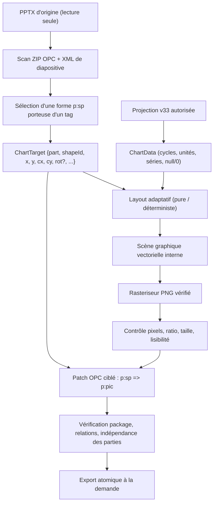

# ADR — Graphiques Office adaptatifs (PPTX)

**Statut :** proposition technique structurée par Winston, à faire valider avant développement.
**Date :** 2026-11-08  
**Portée :** extension de l'architecture Office existante, particulièrement AD-03, AD-05, AD-07, AD-08 et AD-10 ; pas de remise en cause de ces décisions.  
**Contrat UX :** [Option B — Sally](../..//ux-designs/ux-office-graphiques-adaptatifs-2026-11-08/CONTRAT-UX-OPTION-B.md).  
**Story existante :** [SMN-402](https://lmn24.atlassian.net/browse/SMN-402).  
**Paradigme :** *pipeline de rendu déterministe et transformations Open XML minimales* dans le monolithe SMN.

> Ce document formalise une proposition technique et les points encore conditionnés par un POC. Aucun moteur ni modèle Office n'a été modifié dans cette intervention. Les décisions `[PROPOSED]` ne sont pas encore une recette Windows validée.

## 1. Contrat de cohérence



## 2. Décisions à respecter lors du découpage

### AD-OFF-CH-01 — Une cible physique est déterminée avant le rendu [PROPOSED]
**Binds :** découverte des tags, mise en page, rasterisation, insertion.  
**Prevents :** PNG uniforme 960 × 560 forcé dans des cadres de ratios différents.  
**Rule :** pour chaque tag, l'adaptateur PPTX fournit un objet `ChartTarget` immuable comportant au minimum `partName`, identifiant non visuel de forme, chemin/position de la forme dans le XML, `x/y/cx/cy` en EMU, rotation/drapeaux de miroir si présents, locale et options. Le rendu reçoit ce contrat ; il ne cherche jamais lui-même la zone. Les dimensions doivent être positives, bornées et validées. L'extraction des unités et du ratio utilise exclusivement les données Open XML, non les dimensions observées du navigateur.

### AD-OFF-CH-02 — Un seul propriétaire par transformation [PROPOSED]
**Binds :** orchestrateur, renderer et adaptateur PPTX.  
**Prevents :** réécriture concurrente des relations médias, incohérence de l'ordre des formes et duplication de médias.  
**Rule :** le lecteur Open XML est propriétaire de `ChartTarget` ; le moteur de layout est propriétaire des positions des axes/labels ; le rasteriseur ne produit que le PNG ; l'adaptateur PPTX est seul propriétaire des modifications XML, relations OPC et médias ; l'API est responsable de l'autorisation et du diagnostic FR/EN. Aucun des modules ne modifie les données métier v33.

### AD-OFF-CH-03 — Adaptation du dessin à la cible, pas étirement [PROPOSED]
**Binds :** layout, rasterisation, géométrie de l'image.  
**Prevents :** flou, bandes vides et distorsion.  
**Rule :** calculer la mise en page dans le ratio `cx/cy` ; rasteriser à un couple `widthPx/heightPx` calculé à partir de la taille en pouces (`EMU / 914400`) et d'une densité cible comprise provisoirement entre **220 et 300 ppp**. Le ratio des pixels et celui du conteneur doivent différer de moins de **1 %** (arrondi inclus). Aucun `stretch` de contenu dessiné à un autre ratio. Pour une cible dont le format est accepté, préserver strictement ses `x, y, cx, cy` ; ne déplacer aucun autre objet. Les valeurs numériques de densité sont des seuils de POC, pas des garanties universelles.

### AD-OFF-CH-04 — Une scène intermédiaire sépare layout et bibliothèque de dessin [PROPOSED]
**Binds :** six styles de graphiques et rendu FR/EN.  
**Prevents :** remplacement couplé du moteur d'axes par un rasteriseur propre à un environnement.  
**Rule :** un `ChartScene` déterministe décrit zones de tracé, ticks, séries, légendes, glyphes et palettes indépendamment du PNG et de Next.js. Une représentation SVG maîtrisée est le format intermédiaire recommandé. La police matricielle ASCII 5×7 actuelle n'est plus utilisée pour les nouveaux rendus. La couche typographique doit prendre en charge les accents FR/EN, mesurer les textes avant placement et garantir absence de collision/troncature silencieuse. Elle ne dépend pas d'un navigateur visible.

### AD-OFF-CH-05 — Sélection du rasteriseur derrière un port, sous preuve de packaging [PROPOSED]
**Binds :** moteur image, CI, paquet portable Windows.  
**Prevents :** choix prématuré d'une dépendance native indisponible ou d'une police présente seulement sur la machine de développement.  
**Rule :** un port `rasterize(scene, dimensions) -> PNG` isole le moteur. Deux candidats à comparer au POC : (A) rasteriseur SVG→PNG distribué avec Node/SMN ; (B) rendu via Chromium déjà provisionné, uniquement si sa présence fiable et sa distribution sans droits administrateur sont démontrées. Le dépôt contient `puppeteer-core`, mais **ne fournit pas par cela seul une installation Chromium**. Aucun composant externe ou version de bibliothèque nouvelle n'est approuvé sans audit licence/maintenance et preuve de fonctionnement dans le paquet Windows local. Privilégier l'option sans navigateur en production si les résultats visuels et d'internationalisation sont équivalents.

### AD-OFF-CH-06 — Insertion Open XML ciblée et sans perte de maquette [PROPOSED]
**Binds :** adaptateur PPTX, ZIP OPC, tests.  
**Prevents :** reconstruction destructive d'une diapositive, référence image orpheline, dérive visuelle des autres objets.  
**Rule :** remplacer **uniquement** la forme texte `p:sp` identifiée par `p:pic` au même endroit dans `p:spTree`, en réutilisant exactement `a:xfrm` (position, taille, rotation si prise en charge), et en portant l'identifiant non visuel de forme unique. Créer un média PNG sous `ppt/media`, une relation de type image distincte avec `rId` unique dans la partie `ppt/slides/_rels/slideN.xml.rels`, et ajouter le content type PNG seulement si absent. Les parties sans modification utile conservent leur contenu octet pour octet **après décompression** ; les autres relations/médias ne sont pas altérés. Contrôler l'unicité de `p:cNvPr@id`, des relations et des chemins média ; aucune fuite vers une autre diapositive. Le nouveau `p:pic` n'est pas un objet graphique PowerPoint éditable, conformément au contrat UX.

### AD-OFF-CH-07 — Refus déterministe des formes hors périmètre [PROPOSED]
**Binds :** extraction cible et API.  
**Prevents :** résultat ressemblant à une réussite mais erroné.  
**Rule :** la première livraison prend en charge les `p:sp` non groupées dont `p:txBody` ne contient que le tag graphique, avec `a:xfrm` explicite et dimensions valides. Les formes groupées, les transformations imbriquées, les rotations/miroirs non validés, les champs multiples et les zones trop petites sont détectés comme non pris en charge plutôt que rendus de façon incorrecte. La prise en charge des rotations est un candidat POC, non un acquis. Les erreurs portent un code structuré, la partie/diapositive et le tag, puis sont traduites par les ressources `src/i18n/fr.json` / `en.json` sans HTML fourni par le serveur.

### AD-OFF-CH-08 — Pas de régression sémantique ni de changement de tag [ADOPTED]
**Binds :** données v33, graphiques, UX et modèles.  
**Prevents :** deux calculs de séries ou une migration destructrice des templates.  
**Rule :** maintenir la syntaxe `{{CHART:TREND|TYPE=bar|TAGS=...|LAST=6}}` et les six types existants. Les séries viennent exclusivement de la projection de reporting/tendances autorisée, avec convention inchangée : valeurs manquantes distinctes de zéro, mêmes unités en multi-séries, fenêtres et snapshots conservés. Un rapport déjà émis n'est jamais réécrit. Les trois autres cadres de la maquette de test restent inchangés.

### AD-OFF-CH-09 — Budgets et échecs contrôlés [PROPOSED]
**Binds :** moteur PNG, génération API, packaging.  
**Prevents :** explosion mémoire/temps et fichiers ZIP incomplets.  
**Rule :** conserver les limites métier existantes (1–24 cycles, 1–6 séries, au plus 8 Mio par PNG). Proposer pour le POC : une limite de 4096 pixels par dimension et 16 mégapixels par image ; mesurer la mémoire réelle sur 4 graphiques concurrents ; échouer explicitement au-delà des limites, sans réduction silencieuse des données ni dégradation de netteté. La génération reste tout-ou-rien : aucun fichier final si une image ou une relation OPC échoue. Les limites chiffrées doivent être confirmées par les mesures de charge avant d'être déclarées finales.

## 3. Alternatives et arbitrages

| Option | Position | Condition |
|---|---|---|
| PNG adaptatif dans `p:pic` | **Recommandée** pour le premier incrément | Qualité FR/EN et fidélité Open XML validées sous PowerPoint Windows |
| PNG fixe 960 × 560 puis étirement | **Écartée** | Cause actuelle de distorsion et de typographie insuffisante |
| Graphique PowerPoint natif éditable | **Hors périmètre** | Contrat utilisateur : images acceptées |
| SVG incorporé directement comme image Office | **Différé** | Compatibilité variable et gestion des variantes/fallbacks à éprouver |
| Office COM/Interop à l'export | **Écartée** | Serveur Node autonome, installations locales sans privilèges, besoin de portabilité |
| Rasterisation à partir d'un navigateur intégré | **Candidat de comparaison**, pas de choix final | Disponibilité portable et coûts d'exécution démontrés |
| Rendu SVG intermédiaire + moteur isolé | **Recommandé** | Permet d'ajuster la composition et de remplacer le rasteriseur |

## 4. Contrat d'interfaces entre lots

```ts
type ChartTarget = {
  partName: string; shapeId: string;
  xEmu: bigint; yEmu: bigint;
  widthEmu: bigint; heightEmu: bigint;
  rotation?: number; flippedH?: boolean; flippedV?: boolean;
  locale: "fr" | "en";
  options: ChartOptions;
};
type ChartRequest = {
  target: ChartTarget;
  series: ReadonlyArray<{tag: string; name: string; unit: string; values: ReadonlyArray<number | null>}>;
  cycles: ReadonlyArray<{id: string; name: string}>;
};
type ChartScene = {
  widthPx: number; heightPx: number;
  // commandes d'échelle, positions, glyphes, marques, légendes et zones de sécurité
};
type ChartPng = {bytes: Buffer; widthPx: number; heightPx: number};
```

Ces interfaces sont des **contrats de conception** ; le nom exact des types peut être ajusté lors de la revue Amelia, mais pas les frontières de responsabilité sans décision architecturale.

## 5. Plan de développement indépendant (ordre conseillé)

1. **Lot 1 — Découverte/Open XML** : extraire `ChartTarget` pour la forme autonome, tests de ratios horizontal/carré/vertical, contrôles de géométrie, erreurs de cas hors périmètre ; maintenir les tags et la projection.
2. **Lot 2 — Layout/typo et rasterisation** : scènes adaptatives pour six types, choix de moteur après POC, police embarquée avec licence vérifiée, cibles FR/EN, 220–300 ppp sous contraintes, cas 1/6/24 cycles.
3. **Lot 3 — Insertion/OPC** : transformation `p:sp → p:pic` avec relations/médias uniques, absence de distorsion, contrôle des ZIP, aucune modification des autres cadres.
4. **Lot 4 — Validation transversale** : montage Windows portable, 4 cadres (un seul tag puis plusieurs), tests matrice formats/types, contrôle PNG et PDF, intégrité du package, tests Windows/Linux, revue Sally sur le modèle réel.

## 6. Questions ouvertes et points de décision finale

- **Q-01 — Rasteriseur** : quel composant SVG→PNG peut être embarqué sans installation administrateur, fonctionne sur Node 24 Windows/Linux, respecte les polices/accents, les limites de 8 Mio et la licence ? **POC préalable obligatoire ; aucune version de dépendance choisie.**
- **Q-02 — Taille minimale** : seuil réel de largeur/hauteur pour 6 séries ou 24 cycles, à fixer après comparaison sur la maquette, en gardant le seuil UX 9 pt.
- **Q-03 — Rotation/groupes** : prendre en charge le rendu pivoté dès la première livraison ou refuser avec message localisé ? Recommandation : refuser tant que non testé.
- **Q-04 — Couleurs** : les couleurs des indicateurs et le thème graphique : reprendre la palette de tendances existante et stabiliser le mapping tag→couleur sans modifier leur valeur métier.
- **Q-05 — Word** : ne pas étendre implicitement le placement adaptatif DOCX ; ticket distinct après la validation PPTX.

## 7. Preuves requises et garde-fous

- Tests unitaires des conversions EMU→pixels/ratios, des budgets et des erreurs de géométrie.
- Tests image contre captures golden pour les six types × trois ratios et chaînes de caractères accentuées FR/EN.
- Vérifications OPC : relecture ZIP, contrôle du content type et des relations, `rId` / shapeIds uniques, parties non ciblées identiques sur contenu décompressé.
- Matrice 1/2/6 séries, 1/6/24 cycles, null/zéro/négatif, dates et libellés longs, une ou plusieurs diapositives.
- Recette Microsoft PowerPoint Windows 11 **sur le modèle utilisateur réel**, à 100 %, diaporama et export PDF ; vérifier visuellement les autres formes/cadres et la photo.
- `pnpm typecheck`, ESLint ciblé et tests Windows/Linux ; **la preuve de réussite et l'exécution de scripts BMAD doivent être produites après implémentation**, pas inférées.
- Revue d'architecture Winston + conformité UX Sally avant livraison finale.

## 8. Adaptation BMAD et état des vérifications

La présente revue s'appuie sur la lecture du skill Winston, du workflow `bmad-architecture`, des contrats UX/architecture et des fichiers du dépôt GitHub. La commande `uv` du workflow et les scripts `memlog.py` / `lint_spine.py` **n'ont pas été exécutés** dans cet environnement. Un examen manuel de cohérence a été fait, mais ne remplace pas le Reviewer Gate officiel ni une revue indépendante. Les technologies externes et leurs versions n'ont pas été vérifiées sur le web sans autorisation préalable ; c'est pourquoi le rasteriseur final est une question ouverte et non une dépendance imposée.

**Handoff :** faire confirmer les choix/prototypes en architecture, puis découper en US Jira après accord utilisateur et confier l'implémentation à Amelia. Aucune US Jira n'est modifiée dans cette étape.
