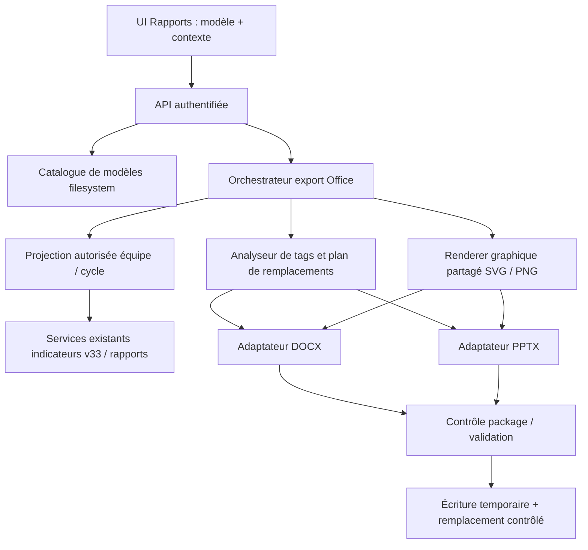

# Architecture BMAD — Rapports Office DOCX/PPTX

**Statut : recommandations d'architecture, revue/POC requis avant engagement de fidélité.**
**Epic de rattachement vérifiée : [SMN-6](https://lmn24.atlassian.net/browse/SMN-6).**

## 1. Paradigme et frontière

**Paradigme retenu :** module d'export de documents *à transformations ciblées sur paquets Office Open XML*, intégré au serveur Next.js de SMN, avec adaptateurs DOCX/PPTX séparés et source de données métier commune. Aucun service externe Office, aucune nouvelle base ni historisation.

## 2. Invariants d'architecture (niveau fonctionnalité)

### AD-01 — Circuit Office indépendant des rapports archivés [ADOPTED]
**Binds :** nouvelle fonctionnalité d'export; **Prevents :** dépendance involontaire aux révisions, archives et exports PDF historiques.  
**Rule :** les modèles `.docx/.pptx` vivent sur disque et sont chargés à la demande ; aucune ligne `smn_report_template`, aucun `smn_report_document`, snapshot ou archive PDF n'est créé ou muté par cette génération Office. Les contrats actuels des exports PDF et des rapports persistés restent inchangés.

### AD-02 — Catalogue et écriture serveur uniquement [ADOPTED]
**Binds :** UI, API et filesystem; **Prevents :** chemins arbitraires et contournements de droits.  
**Rule :** seuls les répertoires configurés `templates` et `generated` sont accessibles via opérations serveur ; l'UI ne transmet qu'un identifiant de modèle issu du catalogue, jamais un chemin absolu fourni par le navigateur. Filtrer extensions, fichiers cachés/temporaires et liens symboliques ; valider les chemins canoniques et le contenu ZIP/Open XML avec limites de taille, d'entrées et de décompression.

### AD-03 — Projection métier commune, autorisée et en lecture seule [ADOPTED]
**Binds :** tous les remplacements ; **Prevents :** écarts entre graphiques/tableaux/valeurs et fuite interéquipes.  
**Rule :** un contexte `{installation, teamId, cycleType, cycleId?, locale}` résolu côté serveur et une projection cohérente en lecture seule alimentent tous les tags. Réutiliser `readReportIndicatorProjection` et les services de rapports/tendances existants après vérification de leurs préconditions. Ne jamais contourner les contrôles d'accès à une équipe ou les règles de données historiques. Zéro ≠ null.

### AD-04 — Contrat typé unique des marqueurs [PROPOSÉ]
**Binds :** parseur, projections, Word/PowerPoint ; **Prevents :** syntaxes et erreurs divergentes.  
**Rule :** un registre de tags distingue `scalar`, `table` et `chart`. Parser la syntaxe et les options avec une grammaire stricte ; limiter longueurs, nombres de lignes, séries et cycles. Tag non reconnu : intact ; tag connu avec valeur absente : `N/D` ; tag connu mal formé ou paramétré : diagnostic explicite, sans interprétation silencieuse. Les exemples `{{...}}` demeurent proposés tant que le contrat produit n'est pas finalisé.

### AD-05 — Mutation minimale et conservation des packages Office [PROPOSÉ]
**Binds :** adaptateurs DOCX/PPTX ; **Prevents :** reconstruction destructive de document.  
**Rule :** lire le ZIP, ne changer que les parties XML et relations nécessaires ; conserver toutes les parties non ciblées, y compris thèmes, masques, média, notes, styles et métadonnées. Remplacer des plages de texte même fragmentées en plusieurs runs avec stratégie de style déterministe à tester ; ne jamais sérialiser/régénérer une page ou une diapositive complète à partir de son rendu visuel. Interdire le contenu macro `.docm/.pptm` pour cette fonctionnalité.

### AD-06 — Tables expansibles sans reflow implicite PowerPoint [PROPOSÉ]
**Binds :** tables Office ; **Prevents :** dépassement et masquage non détectés.  
**Rule :** les tableaux Word dupliquent une ligne modèle compatible avec ses styles ; les tableaux PowerPoint ne sont agrandis que dans les limites géométriques démontrées par le POC. Toute politique de débordement (pages/slides supplémentaires ou refus avec message) est une **décision produit ouverte**, pas un comportement inventé par le moteur. Les tableaux complexes à fusions nécessitent une matrice de compatibilité documentée.

### AD-07 — Graphiques rendus en images par moteur commun [ADOPTED]
**Binds :** tendances UI et exports ; **Prevents :** règles d'échelle et de série divergentes.  
**Rule :** extraire les calculs de séries, échelles, unités, couleurs et légendes dans un module pur réutilisable ; exporter SVG/PNG par un renderer stable sur serveur (ou rendu isolé vérifié), sans capturer artificiellement le composant DOM du navigateur. La capture PNG actuelle de `indicator-trends.tsx` repose sur Canvas, `XMLSerializer` et `document`, donc n'est **pas directement exécutable côté Node**. Les séries de différentes unités restent soumises à `validateTrendSelection`; les titres et libellés suivent la locale.

### AD-08 — Emplacements graphiques explicites [PROPOSÉ]
**Binds :** modèles Office et renderer ; **Prevents :** dimensions imprévisibles.  
**Rule :** chaque image générée remplace un emplacement textuel ou un objet identifié dans le modèle, avec dimensions du cadre préservées et mode `contain` ; modifier uniquement les relations média ciblées. Si les données sont absentes, rendre `N/D` dans l'emplacement sans insérer une image trompeuse. Le POC doit valider ancres, formes groupées et superposition.

### AD-09 — Sauvegarde sûre, confirmation d'écrasement [ADOPTED]
**Binds :** UI/API/filesystem ; **Prevents :** corruption ou écrasement non autorisé.  
**Rule :** générer intégralement dans un fichier temporaire du dossier cible, vérifier le ZIP et le fichier final, puis promouvoir en destination. Une confirmation d'écrasement doit être liée à la cible et à son état (identité/empreinte ou équivalent) et revalidée côté serveur au moment de l'écriture pour éviter les courses TOCTOU. Si l'utilisateur refuse ou si la génération échoue, aucune modification de la cible. La méthode exacte de remplacement atomique sur Windows, y compris fichier ouvert et antivirus, relève du POC. Aucun historique applicatif.

### AD-10 — Contrôle qualité explicite et observabilité minimale [PROPOSÉ]
**Binds :** validation et livraison ; **Prevents :** revendication de fidélité non prouvée.  
**Rule :** tests unitaires parseur/registre/formatage, intégration ZIP/DOCX/PPTX et autorisations, puis tests sur modèles étalons avec comparaison des packages et inspection visuelle Office. Les tests doivent vérifier l'intégrité des sources, les risques de débordement et les échecs d'écrasement Windows. Les erreurs sont signalées dans l'UI sans exposer les secrets ou le contenu des rapports dans les journaux. Aucun script ou POC n'a encore été exécuté pour ce module.

## 3. Constat sur l'existant au 6 novembre 2026

- `package.json` du dépôt : Next.js 16.0.0, TypeScript 5.9.3, React 19.2.0, PostgreSQL via `pg` et Prisma ; aucune bibliothèque spécialisée d'édition DOCX/PPTX déclarée dans les dépendances inspectées.
- `src/server/reports/templates.ts` : modèles de rapports existants persistés en PostgreSQL et révisés. **Ne pas les remplacer** par le nouveau catalogue Office.
- `src/server/reports/studio-export.ts` : export PDF avec contrat de qualité et exclusion des blocs chart/image/table non pris en charge ; **ce contrat ne s'applique pas au nouveau circuit Office**.
- `src/server/reports/dynamic-indicators.ts` : projection des indicateurs d'une équipe et d'un cycle, retour explicite de `available` et `reason`, lecture v33 ; intégration potentiellement réutilisable sous autorisation serveur.
- `src/app/app/admin/indicators/indicator-trends.tsx` : export PNG à partir d'un SVG puis Canvas dans le navigateur ; types multiples et multi-séries, six séries maximum avec unité cohérente. Nécessité d'un rendu partagé compatible export serveur.
- Aucune bibliothèque Open XML externe ni stratégie de réécriture de fichiers Office n'est ici **approuvée**. Les versions, licences, maintenance et compatibilité Node/Windows sont à confirmer lors du POC, sans recherche web avancée non autorisée.

## 4. Plan de preuve de concept obligatoire avant développement complet

| POC | Entrée | Preuve attendue |
|---|---|---|
| P1 | Word avec tags fractionnés, gras, liens, tableaux, en-tête/pied | Remplacements exacts, package ouvrable, éléments hors cible préservés |
| P2 | PowerPoint avec masque, formes, thèmes, notes, tag fragmenté | Slides/positions non modifiées hors zones cibles, rendu Office contrôlé |
| P3 | Word/PPTX avec tableau de 0/1/N lignes et fusions | Styles cohérents, `N/D` et limites documentées |
| P4 | Images de tendance multi-séries | Série correcte, image nette, légendes, proportions et unités |
| P5 | Destination absente/existante/verrouillée + panne volontaire | Pas de perte du fichier original, confirmation et concurrence maîtrisées |
| P6 | Fichiers falsifiés, ZIP bomb, chemins hors racine, accès équipe interdite | Rejet et absence d'accès aux données ou chemins hors périmètre |

**Gate de faisabilité :** P1–P6 documentés avec preuves sur l'environnement Windows 11 local avant d'affirmer une fidélité visuelle garantie ; pas de validation par la seule présence de code.

## 5. Alternatives examinées

- **Conversion/régénération complète des documents** : écartée car détruit potentiellement les styles et la mise en page demandée.
- **Automatisation Office via COM** : écartée comme dépendance forte à une installation Office et à une session interactive ; non adaptée au serveur Node local.
- **Graphiques Office natifs** : exclus explicitement par le choix utilisateur ; les graphiques sont des images.
- **Nouvel historique/DB de modèles** : exclus explicitement ; incompatibles avec le périmètre simple.
- **Manipulation directe du package Open XML** : privilégiée comme approche de POC, sans bibliothèque spécifique approuvée à ce stade.

## 6. Questions ouvertes pour John / Product Owner

- **Q1 — Débordement PowerPoint :** stratégie de limitation, nouvelle diapositive ou échec explicite si un tableau ne tient plus.
- **Q2 — Valeur trop longue :** conservation avec débordement signalé, troncature explicitement demandée ou avertissement.
- **Q3 — Cadre de placement :** balise seule dans forme/zone texte ou convention d'emplacement réservé plus structurée.
- **Q4 — Nom de sortie :** règle et possibilité de modification par l'utilisateur.
- **Q5 — Langue :** locale de l'utilisateur, de l'équipe ou paramètre du modèle.
- **Q6 — Tags v1 :** jeux de données tableaux et graphes réellement prioritaires, limites acceptables.
- **Q7 — Fichier existant :** comportement exact si fichier verrouillé par Office ; recommandé : refus clair sans modification.

## 7. Handoff BMAD vers John

**Epic Jira cible confirmée : [SMN-6 — Composer, exporter et retrouver des rapports professionnels](https://lmn24.atlassian.net/browse/SMN-6).** Ne pas détourner le travail vers SMN-336 (indicateurs) ou SMN-353 (Dashboard Builder). Les nouvelles Stories doivent décrire les exports Office comme un circuit distinct des exports PDF déjà archivés. Privilégier des Stories indépendantes, chacune avec valeur, critères observables, dépendances, tests et mentions des décisions encore ouvertes. Rédiger d'abord dans BMAD ; **ne pas créer/modifier Jira sans accord explicite sur les Stories**.

Références : [spécification fonctionnelle Office](../rapports-office/specification-fonctionnelle.md), [Epic SMN-6](https://lmn24.atlassian.net/browse/SMN-6), [skill architecture](https://github.com/JeanLamora75/SMN/tree/main/.agents/skills/bmad-architecture).
