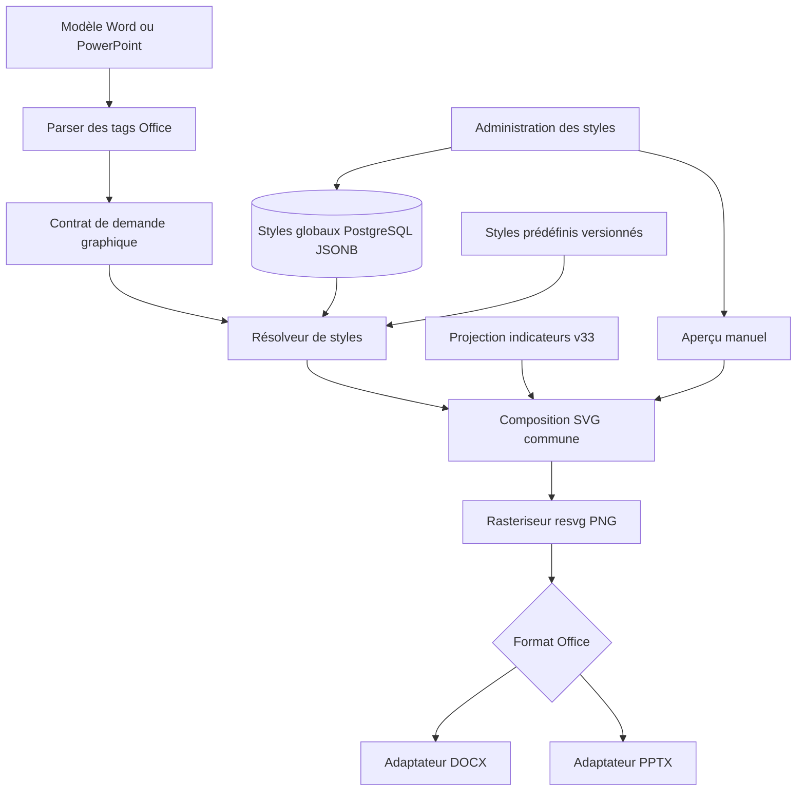

# SMN — ARCHITECTURE-SPINE : catalogue des styles graphiques Office

**État : architecture finalisée pour cadrage approuvé ; implémentation non autorisée à ce stade.**  
**Date : 2026-11-08** · **Responsable : Winston (BMAD Architect)** · **Périmètre : exports DOCX/PPTX, administration globale**

## Paradigme
**Pipeline de rendu côté serveur, déclaratif et versionné** : projection des indicateurs v33 → résolution du style → composition SVG commune → rasterisation PNG → insertion OPC dans DOCX/PPTX. Les valeurs et les styles restent deux responsabilités séparées.

## Contraintes héritées
- Styles globaux, préconfigurés et personnalisables ; un défaut par type.
- Surcharge facultative par `STYLE` dans les tags Office ; aperçu uniquement à la demande.
- Six types : `bar`, `line`, `area`, `pie`, `donut`, `gauge`.
- Le tag `{{CHART:TREND}}` et les paramètres existants `TYPE`, `TAGS`, `LAST` continuent de fonctionner.
- Conservation des données v33, limites de 1 à 24 cycles et de 1 à 6 séries, cohérence d'unités, jauge 0–100 %, aucune édition des archives.
- Aucune dépendance à `uv` pour exécuter SMN.

## Architecture logique



## Décisions d'architecture

### AD-01 — Source de vérité et identifiants
- Les styles prédéfinis, immuables, sont définis dans un catalogue TypeScript versionné (`cockpit-agile`, `corporate`, `minimal`).
- Les styles personnalisés et les associations type → style par défaut sont persistés en PostgreSQL, portée globale de l'installation.
- Identifiant stable indépendant du nom visible, unicité et contrôle de concurrence par révision.
- Version de schéma JSON explicite (v1). La validation et les migrations relèvent du serveur.

### AD-02 — Règle de résolution unique
- `STYLE=slug` explicite → style correspondant, sinon défaut du type, sinon style de compatibilité.
- La surcharge explicite absente ou invalide ne déclenche jamais de repli silencieux : erreur contextualisée avant sauvegarde.
- La configuration est chargée **en lot une seule fois par génération**, pas par graphique.
- Le type demandé par `TYPE` reste la vérité de représentation. Un style est applicable à tous les types, avec un sous-ensemble de propriétés par type.

### AD-03 — Isolation du calcul des données
- La projection v33 reste seule responsable des séries, des cycles, des unités et des valeurs.
- Aucun paramètre d'apparence n'est transmis au moteur de calcul des indicateurs.
- Les valeurs manquantes restent distinctes de zéro et ne sont jamais inventées.

### AD-04 — Moteur SVG commun
- Une fonction pure `composeChartSvg(data, type, options, target)` réalise la mise en page.
- Les deux formats utilisent **le même SVG et le même rasteriseur** (`@resvg/resvg-js`, version déjà présente dans `package.json`).
- Seuls les adaptateurs d'insertion restent distincts : géométrie, images, relations XML/ZIP et remplacement de tag.
- Les documents Office comportent des PNG non éditables comme graphiques natifs. Aucun changement d'Office XML inutile.

### AD-05 — Compatibilité avec les modèles existants
- Le rendu sans `STYLE` ne casse pas les tags existants.
- Un profil `legacy` reproduit autant que possible le comportement historique, vérifié par tests d'images ; aucune promesse de rendu pixel-identique avant recette.
- Pas de migration destructive du rendu Word ; retrait de l'ancien moteur seulement après comparaison et recette.
- Un rapport archivé n'est pas régénéré automatiquement.

### AD-06 — Administration, permissions et intégrité
- Écritures réservées aux administrateurs, lectures contrôlées selon droits de génération et d'administration.
- Validation serveur de chaque champ, plage, couleur, texte et référence. Aucune injection brute de SVG ni XML.
- Gestion des suppressions : prédéfinis non supprimables ; style par défaut non supprimable avant réaffectation ; avertissement pour références de tags présentes dans des modèles hors catalogue.
- Opérations de modification optimistes, atomiques et auditables.

### AD-07 — Performance et sécurité
- Aucun chargement de la configuration graphique dans les pages sans graphique.
- Aperçu recalculé uniquement sur action explicite, avec données de démonstration et limites plus faibles que l'export.
- Budget d'image, géométrie minimale, bornes sur séries/cycles/nombre d'images et rejets explicites ; protections contre saturation mémoire.
- Baseline obligatoire sur DOCX/PPTX (1, 3 et 6 graphiques, plusieurs dimensions). Objectif proposé de régression de durée médiane ≤10 %, **à mesurer**, pas une garantie.

## Forme de données indicative (seed, non contrat API public)
```json
{
  "schemaVersion": 1,
  "id": "corporate-custom",
  "name": "Corporate personnalisé",
  "basedOn": "corporate",
  "revision": 1,
  "common": {
    "palette": ["#17345f", "#3f77b5"],
    "background": "#ffffff",
    "legend": { "visible": true, "position": "bottom" },
    "labels": { "visible": false, "decimals": 2 }
  },
  "types": {
    "line": { "strokeWidth": 3, "marker": "circle" },
    "donut": { "innerRadiusPercent": 58 },
    "gauge": { "min": 0, "max": 100 }
  }
}
```
Les propriétés et leurs bornes détaillées seront contractualisées lors du découpage technique. Les champs inconnus sont refusés ; aucune exécution de code contenu dans le JSON.

## Couche API cible (seed)
- Lecture du catalogue global et des styles effectifs : `GET /api/admin/chart-styles`.
- Écriture d'un style et révisions avec contrôle d'autorisation : routes administratives dédiées.
- Prévisualisation à la demande : `POST /api/admin/chart-styles/preview`, renvoyant un PNG.
- Le générateur Office consomme les styles via un service serveur partagé ; l'API d'export demeure inchangée côté contrat métier sauf pour l'acceptation de `STYLE` dans les modèles.

## Séquence de livraison architecturale
1. Tests de référence et base de performance.
2. Modèle, validation, migration non destructive et résolveur de style.
3. Moteur SVG partagé avec compatibilité des tags.
4. Interface d'administration et aperçu manuel.
5. Harmonisation des adaptateurs Office, documentation et recette.

## Hors périmètre et questions différées
- Graphiques Office natifs éditables ; SVG embarqué dans Office ; nouveaux moteurs de données ; styles spécifiques aux équipes.
- Métriques de rendu précises à mesurer localement ; seuil final de performance à approuver avant la recette.
- Détails techniques de migration et de CSS à choisir au niveau des futures Stories.

## Références du code vérifiées
- `scripts/smn-402-trend-png.mjs` : ancien rendu Word en pixels, 960×560.
- `scripts/smn-412-adaptive-chart.mjs` : layout SVG et `resvg`.
- `scripts/smn-402-office-chart-tags.mjs` : parseur `TYPE/TAGS/LAST`.
- `scripts/smn-413-adaptive-pptx.mjs` : insertion dans les formes PPTX.
- `src/server/reports/office-indicator-charts.ts` : projection des données.
- `src/app/api/admin/reports/office-templates/generate/route.ts` : orchestration.
- `docs/UX-REFERENTIEL-BMAD.md` : contraintes visuelles Cockpit Agile.

**Statut des validations :** revue statique du code effectuée ; aucun script `uv`, test applicatif, benchmark ou pipeline GitHub exécuté.
