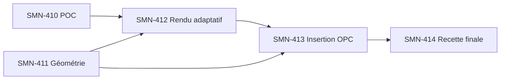

# SMN — Découpage produit : graphiques Office adaptatifs (Option B)

**Auteur :** John — Product Manager BMAD  
**Date :** 2026-11-08  
**Portée :** Epic Jira [SMN-6](https://lmn24.atlassian.net/browse/SMN-6), extension des graphiques d'exports PowerPoint.  
**Statut :** découpage et créations Jira publiés ; développements et recettes non engagés par ce document.  
**Approbation métier :** Option B (dimensions adaptatives) approuvée par l'utilisateur avant ce découpage. Les décisions techniques [PROPOSED] de Winston restent à éprouver par POC.

## Entrées normatives

- [SMN-402 — Graphiques Office existants](https://lmn24.atlassian.net/browse/SMN-402).
- [SMN-405 — Recette Office existante](https://lmn24.atlassian.net/browse/SMN-405).
- [Contrat UX Sally et UX-CH-01 à UX-CH-15](../ux-designs/ux-office-graphiques-adaptatifs-2026-11-08/CONTRAT-UX-OPTION-B.md).
- [ADR Winston sur le rendu et l'insertion Open XML](../architecture/rapports-office/ADR-GRAPHIQUES-ADAPTATIFS-PPTX-2026-11-08.md).
- [Architecture Office existante](../architecture/rapports-office/ARCHITECTURE-SPINE.md).
- [Référentiel UX du projet](../../../docs/UX-REFERENTIEL-BMAD.md).

## Besoin utilisateur et périmètre

**En tant que** Scrum Master ou RTE, **je veux** insérer des graphiques SMN nets et adaptés à chaque emplacement de mes modèles PowerPoint, **afin de** présenter les résultats du sprint sans reconstruire le graphique ni reprendre sa mise en page.

**Accepté :** conserver les tags existants, les six types de graphiques, la projection historique v33 et la mise en forme du modèle Office hors du graphique ; privilégier PNG haute définition adaptatif ; refuser explicitement les zones trop petites/non prises en charge ; rendre la qualité vérifiable sous Office Windows 11.

**Hors périmètre de cette extension :** remplir ou modifier les trois autres cases vides de la capture ; modifier les indicateurs et leurs valeurs ; graphique natif PowerPoint éditable ; mode vectoriel directement embarqué ; nouveau système de génération Word adaptatif ; installation locale d'un IDE ou de composants nécessitant des droits administrateur.

## User Stories créées dans Jira

| Jira | Story et valeur utilisateur | Livraison vérifiable | Pré-requis |
|---|---|---|---|
| [SMN-410](https://lmn24.atlassian.net/browse/SMN-410) | POC de moteur de rendu portable | Choix fondé sur des mesures de qualité FR/EN, mémoire, licences et packaging Windows sans droits admin ; aucun nouveau moteur imposé sans preuve | SMN-402 et ADR Winston |
| [SMN-411](https://lmn24.atlassian.net/browse/SMN-411) | Reconnaissance des cadres PowerPoint | Contrat ChartTarget EMU, tests horizontal/carré/vertical, cas non pris en charge clairement rejetés | SMN-402 |
| [SMN-412](https://lmn24.atlassian.net/browse/SMN-412) | Composition et rasterisation adaptatives | PNG au bon ratio, axes/typo/légendes lisibles, 6 types, 1–6 séries et 1–24 cycles ; limites mesurées | SMN-410 + SMN-411 |
| [SMN-413](https://lmn24.atlassian.net/browse/SMN-413) | Insertion Open XML sans perte de maquette | Transformation ciblée p:sp→p:pic, relations et médias uniques, vérifications ZIP, aucun objet voisin déplacé | SMN-411 + SMN-412 |
| [SMN-414](https://lmn24.atlassian.net/browse/SMN-414) | Recette et conformité utilisateur | Captures avant/après modèle réel, PowerPoint/diaporama/PDF, CI Win/Linux, avis Sally + Winston | SMN-410 à 413 ; complément SMN-405 |

## Ordre de réalisation

- **Piste A :** SMN-410 et SMN-411 peuvent démarrer en parallèle, car la lecture EMU est indépendante du choix du rasteriseur.
- **Piste B :** SMN-412 attend le POC et le contrat de cible validé ; conserver l'ancien moteur tant que les preuves ne sont pas suffisantes.
- **Piste C :** SMN-413 utilise les sorties produites par les deux stories précédentes.
- **Piste D :** SMN-414 qualifie le vrai fichier utilisateur sans supposer que des tests ZIP suffisent à prouver la fidélité visuelle.

## Couverture des exigences UX et de l'architecture

| Critères UX | Story responsable |
|---|---|
| UX-CH-01 / 02 dimensions et ratios | SMN-411, SMN-412, SMN-413 |
| UX-CH-03 / 04 occupation et titre redondant | SMN-412, SMN-414 |
| UX-CH-05 / 06 police, accents, ticks, libellés | SMN-410, SMN-412, SMN-414 |
| UX-CH-07 / 08 séries, unités, null/zéro | SMN-412, SMN-414 |
| UX-CH-09 six styles | SMN-410, SMN-412, SMN-414 |
| UX-CH-10 / 11 tags et maquette intacte | SMN-411, SMN-413, SMN-414 |
| UX-CH-12 messages FR/EN d'échec | SMN-411, SMN-412, SMN-413, SMN-414 |
| UX-CH-13 budgets | SMN-410, SMN-412, SMN-413 |
| UX-CH-14 preuves Windows/Linux/PowerPoint réel | SMN-410, SMN-414 |
| UX-CH-15 documentation tags FR/EN | SMN-414 |

**Décisions Winston :** AD-OFF-CH-01/02/07 → SMN-411 ; AD-OFF-CH-03/04/05/09 → SMN-410 et SMN-412 ; AD-OFF-CH-06 → SMN-413 ; AD-OFF-CH-08 → SMN-412/413 et régressions SMN-414.

## Définition de Done commune

1. Résultat métier observable pour la story, avec tests des cas heureux, limites et erreurs.
2. Aucune modification de la source de données v33, des rapports déjà générés ni des cadres non porteurs de tags.
3. Compatibilité Node 24 et paquet Windows local sans droits administrateur (le POC mesure/atteste, non présume).
4. `pnpm typecheck`, ESLint ciblé, tests automatiques Windows/Linux ; référence précise des runs GitHub dans Jira.
5. Diagnostics traduits FR/EN, sans texte serveur injecté comme HTML.
6. Mise à jour du catalogue de tags et documentation BMAD selon les impacts de la Story.
7. Pour SMN-414, validation visuelle sur le modèle PowerPoint réel à 100 %, en diaporama et PDF par Sally, avec revue d'architecture Winston et accord utilisateur.

## Risques et arbitrages à vérifier avant construction

- **Rasteriseur :** aucun nom de dépendance ni version n'est approuvé avant résultats du POC et vérification de sa licence.
- **Rendu 9 pt minimum :** contrainte d'accessibilité visuelle ; une zone trop petite doit produire une erreur, pas une police illisible.
- **300 ppp :** objectif initial dans une plage 220–300 ; compromis mémoire/qualité à mesurer.
- **Rotations/formes groupées :** support non démontré ; rejet explicite dans le premier incrément.
- **Compatibilité Word :** ses graphiques restent fonctionnels, mais pas d'automatisation du dimensionnement DOCX dans ce lot.
- **Disponibilité des données :** la tendance sans indicateur actif ou sans données garde les règles existantes (pas de zéro inventé).

## Adaptation du workflow BMAD

Le skill John `bmad-agent-pm` et le workflow `bmad-create-epics-and-stories` ont été consultés. Ce dernier décrit un processus séquentiel de découverte globale avec pauses de validation avant chaque étape. **Adaptation ciblée et explicitée :** le besoin était déjà approuvé (Option B), l'Epic SMN-6 et les contrats UX/ADR existaient, et l'utilisateur a expressément demandé l'écriture immédiate dans Jira et BMAD. Au lieu de recréer les epics du projet, ce document découpe uniquement l'extension liée aux graphiques PPTX ; les étapes interactives du workflow complet et la commande `uv` n'ont pas été exécutées. Ceci n'est pas une exécution certifiée du workflow BMAD de bout en bout.

**Trace de publication :** Jira SMN-410 à SMN-414, référencés depuis SMN-402 et SMN-405. Aucun code applicatif modifié.
