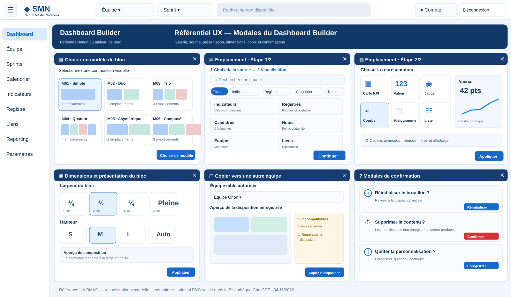

# SMN — Dashboard Builder — Modales de paramétrage Cockpit Agile (référence UX)

**Validation utilisateur :** 4 novembre 2026, direction graphique de la planche des six fenêtres approuvée dans l'atelier Sally.
**Epic Jira :** [SMN-353](https://lmn24.atlassian.net/browse/SMN-353).
**User Story de refonte :** [SMN-381](https://lmn24.atlassian.net/browse/SMN-381).
**Story de restitution liée :** [SMN-380](https://lmn24.atlassian.net/browse/SMN-380).
**Statut :** référence de conception validée — implémentation, accessibilité et recette non vérifiées par cette publication.

## Références visuelles et traçabilité

- [Planche vectorielle versionnée sur GitHub](./modales-parametrage-reference.svg) : **reconstitution schématique**, destinée à faciliter la lecture dans le dépôt ; ce n'est pas le PNG original pixel pour pixel.
- **PNG original validé**, intégralement conservé dans la Bibliothèque ChatGPT de l'utilisateur sous `/SMN/UX/Dashboard-Builder/MAQUETTE-MODALES-COCKPIT-AGILE-2026-11-04.png` (fichier privé, non présent dans GitHub). Ce chemin est propre à la Bibliothèque et n'est pas une URL GitHub.
- La maquette originale et la reconstitution représentent des **états illustratifs côte à côte** de fenêtres utilisées séparément dans l'application, et non six fenêtres ouvertes simultanément.

La maquette est une référence *visuelle* et de hiérarchie. Ses valeurs, sources, boutons et options illustratives ne sont pas des données métier réelles ni l'autorisation d'activer des fonctionnalités non disponibles.

## Contrat de structure non négociable

Conserver le shell partagé de SMN, sans le recréer : `src/app/app/private-shell.tsx`, `private-navigation.tsx`, `active-team-selector.tsx` et `src/lib/private-navigation.ts`.

La barre supérieure claire contient déjà les sélecteurs d'équipe et de sprint, la recherche, le compte et la déconnexion. La barre latérale gauche reste rétractable et soumise aux droits. Le bandeau bleu nuit « Cockpit Agile » appartient **uniquement au contenu métier du Dashboard Builder**, en arrière-plan des modales ; aucun deuxième sélecteur d'équipe, aucun nouveau menu horizontal.

La maquette utilise les tokens et conventions Bootstrap / SMN (`src/app/globals.css`, thèmes light/dark), les zones claires, les bandeaux bleus, les bordures fines, les sélections visibles, les densités lisibles et des contrastes suffisants. Les textes standard doivent être localisés suivant la stratégie JSON FR/EN du projet, pas saisis en dur si cette stratégie s'applique.

## MAQ-P — familles de modales et attendus

### MAQ-P01 — Galerie des modèles M01 à M06

- Fenêtre large, titre « Choisir un modèle de bloc », courte consigne, grille de six **cartes illustrées**.
- Noms métiers Simple, Duo, Trio, Quatuor, Asymétrique, Composé, miniatures montrant les **vraies formes** versionnées, nombre et proportions des emplacements.
- Sélection visuelle explicite : contour et état sélectionné, activable au clavier et annoncée aux technologies d'assistance. Une validation primaire applique le choix au brouillon, sans sauvegarde implicite.
- Pagination conservée si le catalogue dépasse six modèles. Aucune suppression/écrasement silencieux d'un bloc déjà configuré.

### MAQ-P02 — Choix de la source (étape 1/2)

- Recherche en haut ; catégories métier illustrées, clairement nommées : Indicateurs, Registres, Calendrier, Notes, Équipe, Liens, etc. **uniquement si disponibles** dans le registre des sources.
- Résultats en cartes ou lignes lisibles, avec nom métier prioritaire, provenance et unité lorsque pertinentes.
- Sources indisponibles et permissions présentées de façon compréhensible ; refus explicite, sans affichage de codes ou UUID comme principal libellé.
- Étape de progression claire, boutons Annuler / Continuer, navigation Retour sans perte des options utiles.

### MAQ-P03 — Visualisation et options (étape 2/2)

- Choix parmi **les seules représentations compatibles** de la source, en cartes avec pictogrammes, libellés métiers (carte KPI, numérique, jauge, courbe, histogramme, liste, texte) et sélection visible.
- Aperçu à droite sur desktop, en dessous sur mobile ; ne jamais faire croire qu'une donnée de démonstration est une donnée de production.
- Options progressives adaptées à la source (cycle, filtres, tri, nombre, colonnes) ; choix de colonnes par intitulés plutôt que saisie de codes séparés par virgule. Les filtres et options existants gardent leur validation serveur.
- Appliquer ne modifie que le brouillon ; Annuler rétablit l'état antérieur ; pas d'écriture persistante avant l'enregistrement global.

### MAQ-P04 — Dimensions et présentation

- Sélection visuelle des largeurs 1–4 colonnes correspondant exactement à la grille versionnée, états clairement différenciés et miniature dynamique.
- Hauteur compacte / standard / étendue / automatique **si ces choix sont mappés sur les valeurs persistées** ; ne jamais substituer un stockage S/M/L à l'existant sans contrat de migration.
- Réglages clavier/souris/tactile, dimensions adaptées au responsive, annulables sans effet.

### MAQ-P05 — Copie vers une équipe

- Grande fenêtre en deux zones : équipe cible autorisée et impacts ; aperçu graphique de la dernière disposition **enregistrée**, pas du brouillon.
- Signalement intelligible des sources manquantes, sans divulguer de données interéquipes ; avertissement spécifique si des modifications locales ne sont pas enregistrées.
- Confirmation explicite avant remplacement, vérification des habilitations et de la révision optimiste ; seules les dispositions sont copiées, jamais les données métier.

### MAQ-P06 — Confirmations et sorties

- Une famille visuelle commune pour suppression de bloc, changement de modèle destructif, vidage d'emplacement, réinitialisation et sortie avec brouillon modifié.
- Titres et effets précis ; action irréversible visuellement distincte ; bouton Conserver/Annuler toujours identifiable ; Enregistrer et quitter / Quitter sans enregistrer / Continuer la personnalisation pour la sortie.
- Les actions portent sur le **brouillon** sauf validation explicite d'un enregistrement ; aucune perte silencieuse.

## Critères transverses UX / accessibilité

1. Une seule modale active, avec calque et superposition conformes aux usages Bootstrap : focus dirigé dans la modale, piégé pendant l'ouverture puis restauré au déclencheur à la fermeture ; support d'Échap et des rôles/labels ARIA.
2. Titre, étape et consigne lisibles dans le bandeau ; actions de bas de fenêtre stables et accessibles, y compris sur mobile et en présence de contenu défilant.
3. Aucun comportement ne dépend uniquement de la couleur, du survol ou d'un pictogramme ; messages d'erreur contextualisés, confirmables au clavier.
4. Responsive et thèmes light/dark ; modales accessibles depuis un menu gauche réduit et sur petits écrans ; pas de débordement horizontal.
5. Respect strict des droits d'équipe et de la lecture seule, de la saisie en brouillon, des données v33 et de l'historique/snapshots.
6. Les tests existants SMN-363/364/365/366/368/369/371/372/375 continuent de passer et la revue visuelle compare les états importants à la maquette validée.

## Audit du code à la date de validation

- `template-gallery.tsx` : six boutons avec très petites miniatures ; sélection de modèle immédiate et pas encore une galerie visuellement informative.
- `slot-wizard.tsx` : mécanisme deux étapes présent, mais filtres textuels, formes de présentation génériques et champ « Colonnes (codes séparés par une virgule) » à remplacer par une interaction accessible.
- `block-dimensions.tsx` : menu flottant étroit et sélecteurs de colonnes/hauteur en pixels ; transition vers des choix illustrés.
- `dashboard-copy-modal.tsx` : copies et protections existantes, aperçu de disposition principalement textuel, codes des modèles visibles.
- `dashboard-editor.tsx` : confirmations propres à chaque opération et barre fixe de sauvegarde ; harmonisation graphique à réaliser.

Ces constats sont issus de la lecture du code sur GitHub `main`, pas d'une inspection de l'application exécutée.

## Dépendances et responsabilités

Cette référence **complète** les décisions D-DB, A-DB, UX-DB et MAQ-DB-01 à 10, et la [référence de restitution](./REFERENCE-RESTITUTION-VALIDEE.md). Les règles métier, permissions et contraintes techniques existantes prévalent sur les données fictives de l'illustration.

Amelia peut implémenter cette Story sans remodeler l'architecture et les services v33 ; les spécifications et la maquette ne constituent ni des tests ni une validation d'implémentation.

**Traçabilité Jira** : [SMN-381](https://lmn24.atlassian.net/browse/SMN-381) (UX des modales) et [SMN-380](https://lmn24.atlassian.net/browse/SMN-380) (restitution Cockpit Agile).
