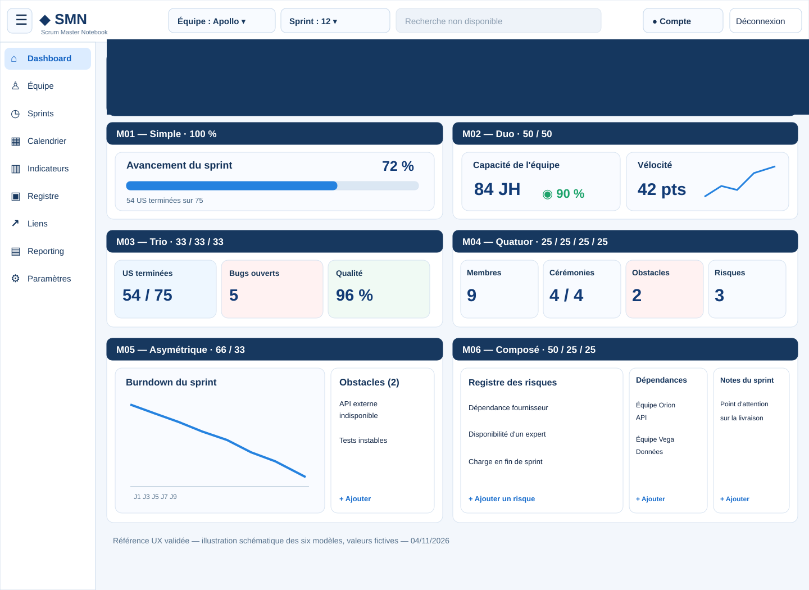

# SMN — Dashboard Builder — Référence graphique de restitution validée

**Révision UX finale :** 4 novembre 2026 — structure complète de l'écran SMN (shell + menu gauche + en-tête), expressément validée par le commanditaire.
**Validation :** 4 novembre 2026, par le commanditaire, lors de l'atelier UX avec Sally (BMAD UX Designer).
**Statut : VALIDÉ — référence graphique de conception ; ne constitue pas une preuve de conformité de l'application.**
**Périmètre :** restitution en consultation et langage visuel du Dashboard Builder Scrum/Kanban.

## Planche de référence

[Ouvrir la planche vectorielle](./dashboard-builder-reference.svg)

**Traçabilité visuelle :** la maquette PNG originale générée et approuvée dans la conversation du 04/11/2026 est la source de la décision. Le fichier SVG versionné est une **reconstitution vectorielle schématique**, pas une copie pixel à pixel du PNG. Les données montrées sont fictives et uniquement illustratives. Ne pas annoncer que le PNG d'origine est archivé dans GitHub.

## Direction validée

- Identité « Cockpit Agile » : **shell réel SMN conservé** (barre globale claire, menu gauche clair rétractable), bandeau de contexte métier bleu nuit dans la zone principale, fond de contenu clair légèrement bleuté, cartes blanches, contours fins, coins arrondis et ombres discrètes. Le bleu nuit ne doit pas recolorer la navigation globale.
- Respect de Bootstrap, des thèmes et des composants existants de SMN ; aucune couleur figée ne doit casser les variantes de thème.
- Hiérarchie lisible : libellé métier, valeur dominante, unité, tendance ou état, densité maîtrisée ; alignements et rythmes constants.
- **En-tête Cockpit Agile obligatoire** : conserver l'en-tête global existant de SMN et son sélecteur d'équipe unique. Le dashboard ne crée **aucun second sélecteur d'équipe**, ni champ ni menu déroulant. Afficher, si pertinent, le nom de l'équipe en lecture seule comme contexte métier.
- Sous l'en-tête global : bandeau de contexte Cockpit Agile bleu nuit, nom du sprint dominant, dates, statut, navigation discrète précédent/suivant, deux zones dynamiques, Actions et Actualiser intégrés ; ne pas revenir à une simple carte blanche isolée.
- La planche illustrative couvre aussi la navigation générale : pour l'implémentation, réutiliser exactement l'en-tête et la navigation réelle de SMN sans ajouter un deuxième système de navigation.
- Les noms et codes **M01–M06 sont des annotations pédagogiques de la planche**, et ne doivent pas apparaître comme bandeaux techniques en consultation. En production, afficher le titre métier personnalisable du bloc et de chaque emplacement.
- Conserver la capacité de construction de plusieurs lignes et blocs par équipe ; masquer les emplacements non configurés sans laisser de trous visuels inutiles.
- Mode consultation = cockpit opérationnel, sans commandes de composition ; mode personnalisation = édition explicite des modèles, titres, sources, visualisations et dimensions.
- Libellés FR compréhensibles, accessibilité clavier et contraste ; responsive desktop/tablette/mobile ; aucune donnée fictive dans l'application.

## Six modèles — intention de présentation

| Modèle | Géométrie cible | Exemple illustratif |
| --- | --- | --- |
| M01 Simple | 1 zone principale | avancement + barre de progression |
| M02 Duo | 2 zones égales | capacité / vélocité |
| M03 Trio | 3 zones équilibrées | US terminées / bugs / qualité |
| M04 Quatuor | 4 zones | membres / cérémonies / obstacles / risques |
| M05 Asymétrique | grande zone + petite zone | Burndown / obstacles |
| M06 Composé | zone majeure + deux zones secondaires | risques / dépendances / notes |

**Attention :** ces six blocs sont rassemblés sur une seule page pour démontrer les modèles et non imposer cette disposition simultanée à tous les dashboards. Les modèles doivent conserver leur géométrie contractuelle versionnée (notamment M04 et M06), même si la planche simplifie les proportions.

## Contrats de restitution

1. **Indicateurs numériques :** valeur prioritaire, unité distincte, titre du KPI, précision conforme au moteur et tendance seulement si calculée à partir d'une source valide.
2. **Jauges :** ratio cohérent avec bornes et unité réelles, borne invalide explicitement signalée ; ne jamais simuler une progression.
3. **Courbes / histogrammes / Burndown :** axe du temps lisible, graduations et libellés utiles, différences entre séries compréhensibles, affichage des absences de données.
4. **Listes métiers :** style de lignes ou cartes adapté au contenu (risques, obstacles, cérémonies, membres, dépendances, liens, notes), badge de statut pertinent, accès à la fiche, action « + Ajouter » en bas de liste lorsque le droit et l'état du sprint le permettent.
5. **Données et état :** cycle sélectionné partagé avec l'en-tête et les blocs sauf exception explicite, gestion chargement/erreur/vide/obsolescence, rafraîchissement manuel et automatique selon cadrage.
6. **Présentation :** titres de bloc et d'emplacement configurables, pas d'UUID ni de codes techniques visibles, espacements et hauteurs harmonisés ; les positions vides ne produisent pas de trous.
7. **Droits et historique :** permissions serveur conservées, lecture autorisée en consultation, respect des snapshots de sprint clos et des règles métier v33 ; aucun calcul KPI réinventé dans les composants graphiques.
8. **Conformité :** vérifier au minimum ordinateur, tablette, mobile, tailles S/M/L, M01–M06, valeurs longues, titres longs, données absentes, droits en lecture seule et période historique.

## Écarts connus à traiter (audit statique du 04/11/2026)

- Les nombres sont rendus par un simple `<output>` ; l'habillage KPI n'a pas encore la hiérarchie de la maquette.
- Les SVG de courbes et barres sont rudimentaires et nécessitent un travail sur axes, labels et lisibilité.
- Le chemin actuel de la consultation ne transmet pas systématiquement le `ratio` requis par une jauge.
- Les listes métiers sont uniformisées en tableaux génériques.
- Les emplacements filtrés peuvent laisser des trous selon la géométrie de grille.
- Le configurateur expose encore des intitulés de visualisations techniques et son aperçu est principalement textuel.

Ces constats ne remplacent pas une recette visuelle dans le navigateur ni les tests fonctionnels.

## Hiérarchie documentaire

Cette version finale respecte le menu gauche et l'en-tête existants de SMN, retire tout sélecteur d'équipe redondant et conserve le bandeau métier Cockpit Agile. **La maquette structurée a été explicitement validée par le commanditaire le 04/11/2026.** Cette décision est **la référence esthétique prioritaire de la restitution Dashboard Builder à compter du 04/11/2026**, en complément des arbitrages D-DB, A-DB, UX-DB et MAQ-DB préexistants. Elle ne remplace pas leurs contrats métier, de droits, de sécurité, de stockage ou d'accessibilité. En cas de conflit réel avec une règle fonctionnelle, demander un arbitrage explicite avant implémentation.

**Publication :** documentation UX uniquement. Aucune modification de l'application, de Jira, ni exécution de tests ou de scripts.

## Avenant définitif — conformité au shell SMN (04/11/2026)

**Validation explicite :** « Ok c’est validé, met a jour la documentation » après présentation de la maquette avec le shell réel. Cette validation prévaut sur les variantes illustratives antérieures dont la barre horizontale et la navigation étaient différentes de SMN.

### Structure normative de la restitution

1. **En-tête global existant** : conserver `src/app/app/private-shell.tsx` avec logo/nom SMN, bouton de rétractation du menu, **sélecteur d'équipe unique**, sélecteur de sprint/période, recherche globale (actuellement indisponible), compte et déconnexion. En-tête clair selon les tokens de thème, non une barre de navigation métier inventée.
2. **Menu latéral gauche existant** : `src/app/app/private-navigation.tsx` et `src/lib/private-navigation.ts` pilotent les entrées et leurs habilitations. En mode Scrum avec droits adéquats : Dashboard, Équipe, Sprints, Calendrier, Indicateurs, Registre, Liens, Reporting, Paramètres. Respecter l'ordre, les intitulés métier définis par les traductions, les entrées conditionnelles, l'état actif, la réduction et le mode mobile. Pas de second menu horizontal.
3. **Contenu principal sous l'en-tête, à droite du menu** : bandeau Cockpit Agile bleu nuit avec équipe en **lecture seule**, sprint sélectionné, dates et statut, flèches de navigation, **deux zones dynamiques**, Actualiser et Actions. Il ne change jamais le contexte d'équipe indépendamment du shell.
4. **Corps du Dashboard Builder** : modèles M01–M06, indicateurs et listes métiers de la maquette validée. Les intitulés techniques des modèles sont pédagogiques et n'apparaissent pas en mode consultation réel. Titres de blocs/emplacements métier, pas d'UUID ni de codes techniques.
5. **Adaptation visuelle** : la zone principale ne chevauche jamais le menu ; les tailles et espacements s'adaptent au menu réduit, au mobile et aux thèmes clair/sombre, en réutilisant les classes et variables de style SMN plutôt qu'en créant un shell concurrent.

### Sources de vérité dans le code

- [PrivateShell](../../../../src/app/app/private-shell.tsx) — structure générale, sélecteurs et contrôles.
- [PrivateNavigation](../../../../src/app/app/private-navigation.tsx) — rendu de la navigation gauche.
- [Configuration du menu](../../../../src/lib/private-navigation.ts) — entrées conditionnelles et ordre.
- [Sélecteur d'équipe](../../../../src/app/app/active-team-selector.tsx) — contrôle existant unique.
- [Styles SMN](../../../../src/app/globals.css) — thème et styles.

**Note de traçabilité :** le PNG original validé demeure dans la conversation ChatGPT, et n'est pas prétendu stocké dans GitHub. Le SVG versionné est une interprétation vectorielle structurelle de l'écran. Les valeurs sont illustratives ; le code SMN reste normatif pour la structure réelle du shell.

### Contrôles de recette obligatoires

- Comparer l'en-tête global et le menu de la page Dashboard Builder aux autres écrans SMN : **aucun doublon** et **aucune navigation inventée**.
- Comparer l'aire centrale au visuel approuvé : bandeau bleu métier, deux KPI d'en-tête, Actions / Actualiser, M01–M06 avec graphiques et listes métiers.
- Vérifier les rôles administrateur et consultation, les modes Scrum et Kanban, le menu réduit et le rendu mobile ; préserver Bootstrap et les thèmes.
- Vérifier que le sélecteur de sprint global et les flèches du bandeau restent synchronisés, et que le contexte d'équipe ne diverge pas.

## Traçabilité Jira de la refonte de restitution (04/11/2026)

La conformité visuelle de cette référence est désormais suivie dans la User Story [SMN-380 — Conformité graphique de la restitution Cockpit Agile au shell SMN](https://lmn24.atlassian.net/browse/SMN-380), enfant de l'Epic SMN-353. Le premier code de refonte est déjà publié sur `main`, mais typecheck, lint, tests et recette visuelle en navigateur restent à prouver ; conserver le statut « À faire » jusqu'aux preuves.

La refonte des modales de paramétrage constitue une Story distincte : [SMN-381](https://lmn24.atlassian.net/browse/SMN-381) ; son [contrat UX validé](./MODALES-PARAMETRAGE-REFERENCE-VALIDEE.md) complète cette référence sans modifier les données métier ni le shell SMN.

## Avenant UX — Carte KPI et liste avec filigrane (05/11/2026)

**Décision validée :** ajouter deux *visualisations* « Carte KPI — Filigrane » et « Liste — Filigrane » ; elles ne constituent pas des modèles géométriques M07/M08. Les cinq vues d'indicateurs existantes, la liste classique et la vue texte sont conservées.

**Traitement graphique imposé :** l'icône choisie et sa couleur configurée sont reprises en arrière-plan de la zone de restitution, **plein centre**, à **90 % de sa hauteur disponible**, sans déformation ni débordement, avec une **opacité fixe de 10 %**. Le contenu, la typographie, les liens, badges et contrôles demeurent à 100 % d'opacité et au premier plan. L'élément décoratif est non interactif et masqué aux lecteurs d'écran ; thèmes Bootstrap clair/sombre et dimensions responsives sont respectés. La lisibilité prime lorsque le contenu se superpose au filigrane.

**Parcours :** choix explicite dans l'étape « Visualisation et options » de l'assistant, vignette illustrative et libellé métier FR/EN ; l'enregistrement reste soumis au workflow de brouillon. Préserver les données v33, les anciennes configurations et les cartes/listes classiques. Vérifier avant codage le raccordement technique de l'icône et de la couleur, sans supposer leur disponibilité dans toutes les sources.

**Recette :** au moins M01–M06, KPI à 0 / absent / en erreur, listes avec lignes, badges et « + Ajouter », titres longs, S/M/L, thème sombre, navigation clavier et chargement après sauvegarde. **État : UX validée, réalisation et tests à démontrer séparément.** Epic [SMN-353](https://lmn24.atlassian.net/browse/SMN-353).
